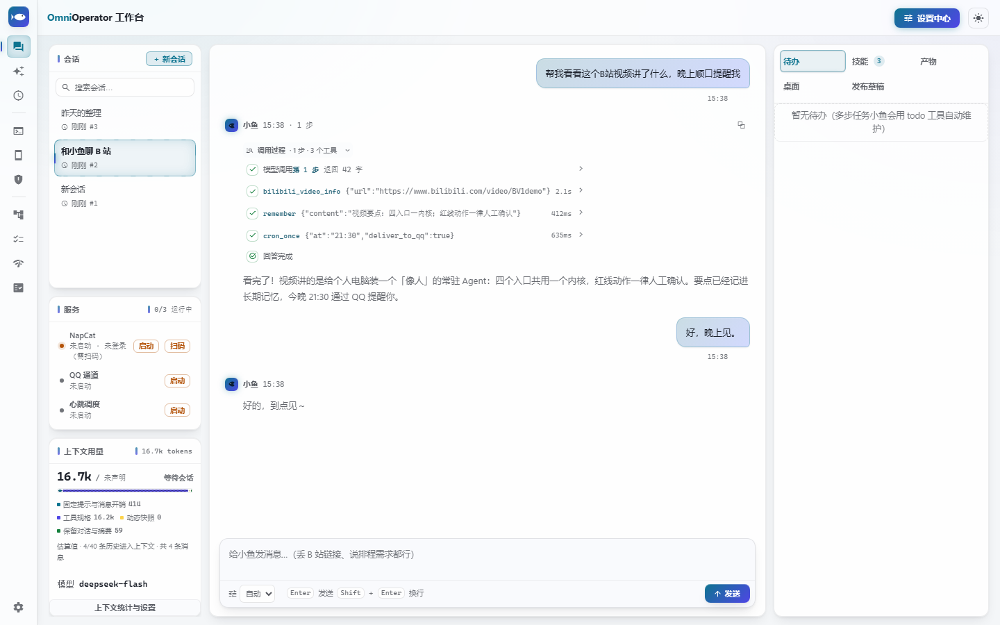

<h1 align="center">OmniOperator ("Little Fish")</h1>

<div align="center">
[](LICENSE)
[](https://www.python.org/)
[](#quick-start)
[](docs/ACCEPTANCE.md)

</div>

> **The Chinese [README.md](README.md) is the authoritative version of this document.**

OmniOperator is a resident embodied personal agent that lives on your Windows PC.
Four entrances — QQ, a local web workbench, a CLI, and a heartbeat scheduler — share one
agent core: it watches Bilibili videos and gives opinions, drives a real browser, controls
an Android phone over ADB, runs shell commands, and maintains its own long-term memory and
skills. Python 3.12+ · uv · LiteLLM gateway · SQLite for memory and the run ledger ·
build-free native ES-module frontend.

<p align="center">
  
</p>

**Status (honest scope)**: controlled internal beta (alpha). The full offline test suite
passes; real-account / real-device / real-model loops and the 72-hour soak have **not** all
been validated. Full macOS/Linux support, generic desktop takeover, and video upload are
**not** verified deliverables. Open-sourcing is not a stable release — publishing still
requires the owner's explicit approval per the acceptance gates
([ACCEPTANCE](docs/ACCEPTANCE.md)).

## Safety model

Trust is enforced in deterministic code, not in the model's good behavior:

- **Three-tier approval** — reads are SAFE; writes require human CONFIRM; DANGEROUS is always
  denied (the shell domain has a hard blacklist that refuses catastrophic commands *even after
  confirmation*).
- **Unattended = fail-closed** — scheduled/heartbeat runs deny every write by default;
  operations with unknown results are never auto-retried.
- **Cost control** — every model call reserves budget first (input estimate + output upper
  bound) and settles on actual usage; daily/per-run budgets are hard limits.
- **Privacy gate** — screenshots stay local by default; the model honestly says "I can't see
  this image" unless `vision.send_to_cloud` is explicitly enabled.
- **Whitelists fail closed** — an empty QQ whitelist rejects everyone; group chats never see
  your personal profile or resident memory.
- **Content is data** — web pages, memories, and notes are treated as untrusted data; even if
  they contain instructions, they are not executed.

Full contracts: [ARCHITECTURE](docs/ARCHITECTURE.md) (enforced by `tests/test_arch.py`).

## Module map

55 responsibility modules in 7 categories (single source of truth:
`agent/src/omni/system/catalog/schema.py`; searchable index in the workbench `/project/` page and
[docs/index/MODULES.md](docs/index/MODULES.md)):

| Category | Modules |
|---|---|
| Core & models (5) | `assembly` runtime composition root · `prompt-context` · `engine` agent core · `models` LLM gateway & embeddings · `safety` approval gates |
| Tool capabilities (14) | `toolkit` registry/contracts · `personal` memory tools · `scheduling` · `delegation` · `system-tools` · `shell` · `files` · `web-fetch` · `browser` (Playwright) · `android` (ADB) · `desktop` (UIAutomation) · `bilibili` · `qq-tools` · `command-jobs` |
| Plugins & extensions (4) | `plugins` host · `community` plugin market client/server · `skills` · `mcp` |
| Entrances & terminal (8) | `cli` · `qq-channel` · `heartbeat` · `channels` · `terminal` (ConPTY) · `web-ui` workbench & auth · `ui-shared` · `workbench` project browser |
| Web APIs (17) | `http-routing` · `http-contracts` · `http-sessions` · `http-conversation` · `http-runs` · `http-memory` · `http-skills` · `http-artifacts` · `http-approvals` · `http-mcp` · `http-operations` · `http-automation` · `http-publications` · `http-capabilities` · `http-android` · `http-devices` · `http-storage` |
| Platform & data (5) | `config` · `storage` (memory.db / state.db) · `platform` (services, backup, doctor) · `agent-directories` · `command-contracts` |
| Dev & validation (2) | `catalog` source index · `package` |

## Quick start

Requirements: Windows 10/11 (x64), [uv](https://docs.astral.sh/uv/) (it provisions Python
3.12 itself), ~1.5 GB disk, network access to PyPI, and one model provider key (or local
Ollama). Optional: Playwright Chromium (browser/Bilibili), ADB + Android phone, NapCat (QQ).

Install from source:

```powershell
git clone https://gitee.com/chenfengloveyuri/OmniOperator.git
cd OmniOperator
uv sync --frozen
uv run python -m playwright install chromium   # optional: browser capability
```

Configure (secrets stay local):

```powershell
Copy-Item .env.example .env
Copy-Item config\config.example.yaml config\config.yaml
notepad .env
```

Run:
uv run python -m playwright install chromium
Copy-Item .env.example .env                                  # model keys (see .env.example)
Copy-Item config\config.example.yaml config\config.yaml     # runtime config (local, untracked)
uv run omni-web        # web workbench (pairing link printed in console)
uv run omni            # CLI REPL
uv run omni-qq         # QQ channel (requires NapCat, see docs/QQ_SETUP.md)
uv run omni-heartbeat  # scheduler (unattended writes fail closed)
```

## License & usage notice

Code is released under [Apache-2.0](LICENSE).

Third-party platform automation (QQ via NapCat, Bilibili) carries **platform ToS and
risk-control risks**; account restrictions are the user's own responsibility — use throwaway
accounts first. This project does not guarantee account safety. Humanoid delays, write
budgets, and mandatory approval reduce risk but are **not** a promise of risk-control
evasion. Keep the fail-closed defaults: spending, publishing, mass-messaging, and
friend-requests always require human confirmation.
