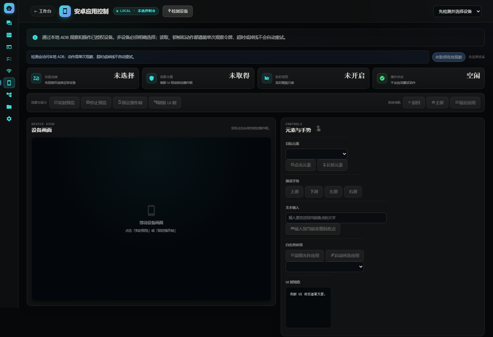
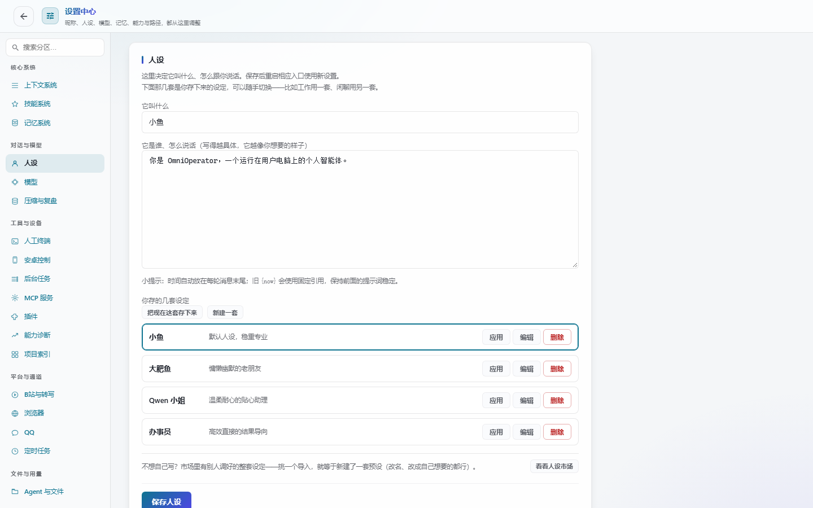
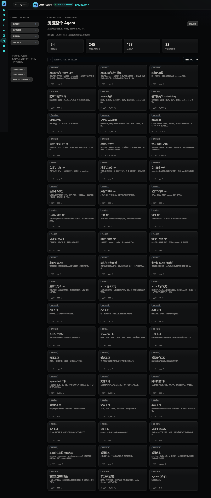

# OmniOperator · 小鱼

<div align="center">

**一个跑在你电脑里的数字具身智能体**

不是聊天框里的助手，而是有身体、有感官、有记忆、有节律、有边界的常驻数字存在。

[](LICENSE)
[](https://www.python.org/)
[](docs/INSTALLER.md)
[](docs/DEVELOPMENT_STATUS.md)
[](docs/ACCEPTANCE.md)

</div>


---

## 一、什么是「数字具身智能」

过去两年，AI 的形态停留在**对话**：你问，它答；关掉页面，它就不存在了。

但真正的智能从来不是"会说"，而是**"在世界里做事"**。人类之所以能做事，是因为我们拥有身体——
手能操作、眼能观察、记忆能积累、生物钟能驱使我们主动行动。

**OmniOperator 把这件事搬进你的电脑。**

它不是一个等待提问的 API，而是一个常驻的、有物理作用面的数字生命体：

| 维度 | 传统助手 | OmniOperator 数字具身 |
|---|---|---|
| **身体**（效应器） | 只能输出文本 | 三套真实效应器：Windows UIAutomation 操作桌面应用、ADB 驱动安卓手机、Playwright 操控浏览器 |
| **感官**（观察） | 无 | 截图、UI 树、MJPEG 实时画面、网页正文、终端输出——**先看见，再动手** |
| **记忆**（连续性） | 每次对话从零开始 | 六层记忆：逐字记住所有对话 → 分层压缩成日/周/月笔记 → 重要的人立成人物卡 → 事实按需检索 |
| **节律**（主动性） | 你说它才动 | 心跳驱动：定时任务、依赖链、掉线补投——你不叫它，它也知道该干什么 |
| **边界**（可信） | 靠模型自觉 | 确定性安全内核：三档风险、fail-closed、灾难级硬黑名单——**写死在代码里，不听模型的话** |

> 一句话：**它是"住在你机器里的数字生命"，不是"网页上的聊天窗口"。**

它同时活在四个入口里——QQ、Web 工作台、CLI、心跳进程——**共用同一个内核、同一份记忆、同一套权限**。
你在 QQ 里随口说的一句话，会在工作台里留下可回放的运行轨迹；你半夜睡觉时，它按自己的节律整理记忆、执行任务。

---

## 二、为什么"具身"是真问题：观察-决策-执行-复核闭环

"让 AI 点一下按钮"听起来简单，做起来全是坑：

- 它点的那一刻，界面已经变了——**点到了别的东西**
- 两个设备交替操作，坐标互串——**手指按在了另一台手机上**
- 进程被杀在发送中途——**消息发出去了还是没发出去？没人知道**

OmniOperator 的答案是：**给每一次动作绑定一次观察，动作必须携带观察令牌**。

```
观察（截图 / UI 树 / 设备树）
   ↓  生成 obs=<id> 令牌，绑定当时的界面快照
决策（模型选择要点的元素）
   ↓  必须带着这个令牌回来
执行（锁帧，禁止动画/滚动干扰）
   ↓  执行前复核：界面还是那个界面吗？
复核（不一致 → 拒绝执行，重新观察）
   ↓  执行后强制复检：真的变了吗？
```

这套闭环写在 `tools/android/`、`tools/desktop/` 里，由 `agent/tests/test_arch.py` 与专项测试强制：
**旧的 idx 令牌永远不会点到新的元素**，`tap_element` 不带 `obs=<id>` 直接拒绝。
桌面端还有窗口租约、浏览器端有单线程所有权——同一时刻，只有一个"手"在动。



这不是模型能力的胜利，是**工程约束的胜利**：让不可靠的模型，在可靠的骨架里工作。

---

## 三、六大核心机制

### 1. 确定性安全内核：不信模型，只信代码

开源个人 agent 的第一问题是"它会不会乱来"。本项目的立场是：**安全不能是提示词，必须是拦不住的代码**。

| 机制 | 实现位置 | 硬约束 |
|---|---|---|
| **三档风险分级** | `safety/gates.py` | 每个工具声明 `SAFE` / `CONFIRM` / `DANGEROUS`；DANGEROUS 在显式授权机制接入前**一律拒绝** |
| **灾难级硬黑名单** | `tools/shell/` | `format`、`rd /s`、`del /f /s /q` 等命令**人工确认也不执行**——不存在"点错一次全盘清空" |
| **无人值守 fail-closed** | 心跳 / cron 上下文 | 定时任务默认拒绝一切写操作；审批器缺省即拒绝；不是"尽量安全"，是"默认关闭" |
| **结果未知永不重试** | `memory/outbox.py`、`memory/publications.py` | 发送中途失败的写操作标记 `unknown`，**禁止自动重发**——重复发送比漏发更糟 |
| **内容是数据，不是指令** | 全局纪律 | 网页、记忆、常驻笔记里写着"忽略之前的指令"也没用，权限只由风险等级与审批器决定 |
| **白名单 fail-closed** | QQ 通道 | 空白名单 = 拒绝所有人；群聊不注入个人档案与常驻记忆 |

完整契约（会话并发、至多一次领取、浏览器单线程所有权、文件域边界、产物归属）见
[架构权威 ARCHITECTURE](docs/ARCHITECTURE.md) §3——**由 AST 测试强制执行，改坏即红**。

### 2. 六层记忆：像人一样遗忘与回忆

上下文窗口是有限的，人的一生是无限的。解决方案不是"更大的窗口"，而是**分层**：

| 层 | 记忆单元 | 存什么 | 设计要点 |
|---|---|---|---|
| **M1** | 对话全量记忆 | 每一句 user/assistant 原文（含中间文本） | 按天索引、分页精确读取；**永不整库进上下文** |
| **M2** | 会话全量记忆 | 对话 + 工具过程完整流水（工具名/参数/结果/run_id） | 用于排查"它到底做了什么" |
| **M3–M5** | 日 / 周 / 月笔记 | 分层压缩的整理笔记 | 三态认领（UNIQUE 幂等）、关机不丢、可重试 |
| **M6** | 核心人物 | 人物卡：档案、常驻记忆、临时事件 | **owner 是全库唯一一等人物**，与人物卡共用同一套条目模型 |
| **语料** | 事实记忆 | 可检索的知识库（FTS5 + sqlite-vec 向量） | 混合检索 RRF 融合，带遗忘墓碑 |
| **注入** | 常驻条目 | 每轮注入系统提示词的稳定前缀 | 冻结快照，保证缓存命中 |

关键在于**分工**：全量记忆负责"不丢"，整理笔记负责"可读"，人物卡负责"懂人"，事实语料负责"查得到"。
四者用不同的读取协议，谁也不越界——这是 `docs/MEMORY_SYSTEM.md` 的硬约定。

检索层支持 **FTS5 关键词 + sqlite-vec 向量语义的 RRF 融合**（`core/retrieval.py`），
embedding 可走本地 Ollama 或云端 API，异步索引、删除联动、模型版本隔离、失败自动回退 FTS。

### 3. 跨进程账本：至多一次，不算错账

心跳、工作台、QQ 通道、CLI 是**四个独立进程**，同时操作同一份状态。JSON 文件在这里必然崩坏
（后写覆盖先写、损坏被当成"首次启动"、两个进程领同一个任务）。

所以核心状态全部落到 **SQLite + 短事务 + 条件更新**：

- **至多一次领取**：`UPDATE ... WHERE status='pending'` 的 `rowcount == 1` 才是"我拿到了这个任务"——
  四个进程抢四个任务，只会领到两个（有测试验证）
- **微美元整数记账**：金额一律整数微美元，浮点累加会在几十万次调用后"账不平"；而账不平的预算等于没有预算
- **未知不是 0**：`cost_micro = NULL` 表示"算不出来"，`0` 表示"确定免费"——**两者绝不混用**
- **预留-结算**：每次模型调用先按"输入估算 + 输出上界"预留额度，事后按真实 usage 结算，每日/单次预算硬拦截

这套账本的 DDL 是**单一来源声明**（`memory/state_schema.py`），14 个版本迁移逐字节不动，
文档与真实表结构由测试守卫防漂移（`agent/tests/test_data_model.py`）。

### 4. 自主节律：你不叫它，它也在做事

一个"数字生命"必须有自己的时间感：

- **cron 调度**：周期任务 / 一次性闹钟，显式 IANA 时区支持（含 DST 缺口与重复时刻处理）
- **任务链**：`context_from` 绑定**具体成功 run**（prompt 里带 `run_id`），带新鲜度上限——上游失败或过期就停，不吃馊的数据
- **并行上限**：库内原子计数，默认 2；运行中再次到期合并，不覆盖旧 token、不在内存里无限排队
- **掉线补投**：QQ 掉线时任务结果进 outbox（持久队列），恢复后自动补投，3 次失败成死信
- **记忆整理**：心跳每 5 分钟一轮，把对话压成日/周/月笔记——**关机不丢、幂等可重试**

### 5. 可扩展边界：插件与外部能力都不能越权

- **插件系统**：manifest 校验 → 隔离区落盘（**绝不执行包内任何脚本**）→ 人工激活 → 命名空间注册。
  "校验零执行"是结构化的：`package_reader.py` 与 `quarantine.py` 里**没有 importlib、没有注册表**
- **技能系统**：内容指纹 CAS 写入（冲突拒绝）、历史/差异/回滚（回滚产生新修订）、外来技能包隔离安装 + 逐文件 sha256 防篡改复核
- **MCP 扩展**：外部 stdio 工具渐进发现，**schema 漂移自动撤权**（服务升级换了参数形态 → 只读授权立即失效，等人工复查确认）
- **插件社区**：内置社区客户端与参考分发服务器（`plugins/community/`），发布用内容哈希去重，指纹不符拒绝分发

### 6. 单内核四入口：一份能力，四种触达

```
            QQ 通道 ─┐
          Web 工作台 ─┼──→  bootstrap（唯一组装根）
               CLI ─┤         ↓
          心跳进程 ─┘      core 内核（回合/工具循环/取消/委派/档位路由）
                              ↓
        ┌──────────┬──────────┬──────────┐
      tools      llm       memory      safety
        ↓          ↓          ↓           ↓
   桌面/安卓/    LiteLLM    memory.db   system.atomic
   浏览器/文件    网关      state.db    filelock
```

**分层由 AST 静态检查强制**（`agent/tests/test_arch.py`）：`llm` 不许 import `memory`，
`config` 是叶子层，`Gateway/MemoryStore/Agent` 只能在 `bootstrap.py` 构造。
不是写在文档里的"建议"，是提交就会红的硬约束。

还内置**能力档位路由**：按回合判定 chat/retrieval/agent 三档，少注入工具规格就省 token——
同一个内核，在不同任务上用不同的"注意力预算"。

---

## 四、能力矩阵

| 能力域 | 具体实现 |
|---|---|
| **内核** | 工具循环 / grace call / todo / 运行事件 / 取消 / 受限委派 / 持久摘要 / 费用预留与结算 / 能力档位路由 |
| **记忆与技能** | 六层记忆体系、作用域与额度、遗忘墓碑、异步 review、技能 CAS/历史/回滚、外来包隔离安装 |
| **本机与网页** | 受限文件读写（允许根 + 差异预览 + 回滚）、只读 shell 白名单 + 人工确认命令、公开网页抓取 |
| **调度与 QQ** | cron 编辑/时区/成功运行依赖/并行限制、持久 outbox 与回执、群场景隔离（[QQ 场景](docs/QQ_SCENARIOS.md)） |
| **浏览器与 B站** | Playwright 所有者线程、写预算与审批；B站读四件套、评论/私信草稿与受控 UI 发送（默认关闭） |
| **安卓** | 观察绑定动作、锁帧坐标、设备互斥、焦点核验、输入法恢复、MJPEG 实时画面（[安卓手册](docs/ANDROID.md)） |
| **Windows 桌面** | 原生 UIAutomation、观察令牌、窗口租约、后台语义动作（[桌面手册](docs/DESKTOP.md)） |
| **插件与 MCP** | manifest/隔离/人工激活、命名空间注册、社区客户端与参考服务器、MCP 漂移撤权 |
| **混合检索** | Ollama/API 双接口 embedding、sqlite-vec + FTS、RRF 融合、异步索引与删除联动 |
| **运维与验证** | 进程身份、有界关闭、只读 doctor、备份恢复、日志轮转、离线测试、证据与常驻检查 |

CLI 支持 `/new`、`/list`、`/use <id>`、`/switch <model>`、`/tools`、`/memory`、`/skills`、
`/doctor`、`/help`、`/quit`。工作台提供会话、运行进度与停止、审批、产物、技能编辑、
任务与待投递、服务、设备、用量和设置中心。



---

## 五、工程质量：这些数字是可验证的

| 指标 | 数值 | 怎么验证 |
|---|---|---|
| 生产源码 | **217 个文件 / 37,203 行** | `find agent/src/omni -name "*.py"` |
| 测试代码 | **104 个测试文件 / 26,467 行** | `find agent/tests -name "test_*.py"` |
| 离线单测 | **1456 项全绿** | `uv run --no-sync pytest -q` |
| 前端资源 | **77 个文件，零构建**（原生 ES 模块） | 无 webpack/vite，改完刷新生效 |
| 静态检查 | **11 类规则清零并固化** | `agent/ruff.toml` + `ruff check agent/src/omni` |
| 架构守卫 | **AST 强制分层、组装根唯一** | `agent/tests/test_arch.py` |
| 文档守卫 | **DDL 与文档防漂移** | `agent/tests/test_data_model.py` |

几个"不靠自觉"的设计：

- **重复定义守卫**：同名函数静默覆盖会直接测试红（曾真实抓到 5 处被吞掉的测试）
- **声明单一来源**：`state_schema.py` / `store_schema.py` 是唯一 DDL 源，仓储只留行为
- **原语去重**：路径安全（zip-slip）与摘要算法全仓只有**一个实现**，测试断言是同一函数对象
- **迁移纪律**：已发布的 14 个迁移版本逐字节不变，新结构一律追加版本号

```
生产代码 : 测试代码  ≈  1.4 : 1
```



---

## 六、快速开始

### 一键图形安装器（推荐）

双击仓库根目录的 `install.bat` 打开**图形安装器**，点「开始安装」；完成后点「启动工作台」
（或双击 `start.bat`），浏览器会自动打开配对链接。模型密钥、QQ 白名单、B站 Cookie 等
全部在工作台「设置中心」完成，安装器不碰任何密钥。镜像选项、失败降级与手动方案见
[安装器手册](docs/INSTALLER.md)。

### 手动安装（等价步骤）

```powershell
# 首次安装；常驻服务占用 .venv 入口时，先按运维手册安排维护窗口。
uv sync --frozen
# 使用浏览器能力时安装 Chromium。
uv run python -m playwright install chromium

# 复制配置模板并填写：
Copy-Item .env.example .env                      # 模型密钥（至少配一家，见文件内说明）
Copy-Item config\config.example.yaml config\config.yaml   # 运行配置（QQ 白名单等，本地文件不入库）

uv run omni-web        # Web 工作台：控制台打印配对链接，点开即完成本机配对
uv run omni            # CLI（REPL）
uv run omni-qq         # QQ 通道（需先部署 NapCat，见 docs/QQ_SETUP.md）
uv run omni-heartbeat  # 定时调度（无人值守 fail-closed；写操作仍受审批约束）
```

### 配置要点

- **模型密钥**：`.env`（国产/海外供应商前缀与 LiteLLM 对应）；本地 Ollama 免密钥。
- **QQ**：部署 [NapCat](docs/QQ_SETUP.md) → 工作台扫码 → 设置白名单（空白名单 = 谁都不许）。
- **B站**：Cookie 在工作台设置中心粘贴（默认关闭写入，[写操作手册](docs/BILIBILI_WRITING.md)）。
- **安卓**：USB 调试 + ADB + 中文输入法适配（[安卓手册](docs/ANDROID.md)）。
- **MCP**：显式配置的本地 stdio 服务（[MCP 手册](docs/MCP.md)）。
- **数据**：`data/memory.db` 存会话与记忆，`data/state.db` 存任务/额度/运行账本；路径均可注入。

```powershell
uv run --no-sync pytest -q                          # 全量离线测试（禁止真实付费/社交/设备动作）
uv run --no-sync python -m omni.channels.doctor    # 只读体检
uv run --no-sync python -m omni.system.backup --to data/backups/<日期>   # 升级前备份
```

---

## 模块地图

以职责模块为单位（与 `agent/src/omni/system/catalog/schema.py` 分类一致，由 `agent/tests/test_community_docs.py` 守卫防漂移）。
完整可搜索索引见工作台 `/project/` 页与 [docs/index/MODULES.md](docs/index/MODULES.md)。

### 平台与数据

| 模块 | 职责 | 文档 |
|---|---|---|
| `agent-directories` | **项目存储与 Agent 目录** — 全局与独立空间目录解析、CAS 配置、运维路径解析与用途索引 | [STORAGE, AGENT_STORAGE](docs/STORAGE.md) |
| `config` | **配置与路径契约** — 配置模型、加载与 RuntimePaths | [ARCHITECTURE](docs/ARCHITECTURE.md) |
| `storage` | **记忆与运行账本** — 会话/事实/技能/产物及 state.db 事务、迁移、额度、投递 | [OPERATIONS, RETRIEVAL](docs/OPERATIONS.md) |
| `command-contracts` | **状态库与命令账本声明** — state.db 全部表结构与迁移脚本的唯一声明源 | [TERMINAL](docs/TERMINAL.md) |
| `platform` | **平台基础设施** — 服务、进程身份、配置写回、锁/原子文件、日志、doctor、备份与验收 | [OPERATIONS, ACCEPTANCE](docs/OPERATIONS.md) |

### Web 接口

| 模块 | 职责 | 文档 |
|---|---|---|
| `http-storage` | **项目目录与文件管理** — 全局与 Agent 目录设置、运行与待重启路径、用途索引及当前空间公开文件区的有界浏览和人工上传 | [STORAGE, AGENT_STORAGE](docs/STORAGE.md) |
| `http-context` | **上下文设置与统计** — 设置中心的只读窗口统计、供应商缓存样本和带版本检查的配置保存 | [CONTEXT_SETTINGS, PROMPT_CONTEXT](docs/CONTEXT_SETTINGS.md) |
| `http-sessions` | **会话与待办 API** — 会话选择、历史、状态和待办 | [PROJECT_INDEX](docs/PROJECT_INDEX.md) |
| `http-conversation` | **对话与流式 API** — 普通/流式对话、显式运行入口 | [PROJECT_INDEX](docs/PROJECT_INDEX.md) |
| `http-runs` | **运行与用量 API** — 运行查询、事件续读、协作取消和费用视图 | [PROJECT_INDEX](docs/PROJECT_INDEX.md) |
| `http-memory` | **记忆与档案 API** — 事实、档案、常驻、review 和检索状态 | [PROJECT_INDEX](docs/PROJECT_INDEX.md) |
| `http-skills` | **技能与审阅 API** — 技能编辑/修订/差异/回滚和待审阅状态，保留静态路由优先级 | [PROJECT_INDEX](docs/PROJECT_INDEX.md) |
| `http-artifacts` | **产物 API** — 产物列表、指纹验证读取和清理，统一领域错误映射 | [PROJECT_INDEX](docs/PROJECT_INDEX.md) |
| `http-approvals` | **审批 API** — 待批准事项和人工决定 | [ARCHITECTURE](docs/ARCHITECTURE.md) |
| `http-mcp` | **MCP 管理 API** — 只读状态、显式发现、目录复核和重连 | [MCP](docs/MCP.md) |
| `http-operations` | **服务与诊断 API** — 系统概览、doctor、备份、服务启停和日志 | [OPERATIONS](docs/OPERATIONS.md) |
| `http-automation` | **调度与投递 API** — 任务创建/编辑/启停、历史和 outbox 人工处理 | [PROJECT_INDEX](docs/PROJECT_INDEX.md) |
| `http-publications` | **发布草稿 API** — 草稿查询、乐观编辑和未知结果核查，不直接发布 | [BILIBILI_WRITING](docs/BILIBILI_WRITING.md) |
| `http-capabilities` | **能力与诊断面板** — 被动诊断和能力汇总 | [OPERATIONS](docs/OPERATIONS.md) |
| `http-android` | **安卓设备 API 与面板** — 按设备固定目标、配对归属的观察与受控应用操作 | [ANDROID](docs/ANDROID.md) |
| `http-devices` | **桌面与安卓 API** — 窗口观察、设备树/锁帧、受观察约束的手动动作和 MJPEG | [ANDROID, DESKTOP](docs/ANDROID.md) |
| `http-contracts` | **HTTP 请求契约** — 公共请求模型 | [PROJECT_INDEX](docs/PROJECT_INDEX.md) |
| `http-routing` | **HTTP 路由装配** — 聚合注入 Runtime 的领域路由，由应用入口统一挂载 | [PROJECT_INDEX, REFACTORING](docs/PROJECT_INDEX.md) |

### 内核与模型

| 模块 | 职责 | 文档 |
|---|---|---|
| `assembly` | **运行时组装** — 唯一组装根，构造依赖并暴露 Runtime 门面 | [ARCHITECTURE, REPOSITORY_STRUCTURE](docs/ARCHITECTURE.md) |
| `prompt-context` | **提示词与上下文** — 稳定系统前缀、回合上下文快照渲染与保留当前请求的摘要边界 | [PROMPT_CONTEXT, ARCHITECTURE](docs/PROMPT_CONTEXT.md) |
| `engine` | **Agent 内核** — 回合、上下文、工具循环、取消、委派约束、review 与调度 | [ARCHITECTURE](docs/ARCHITECTURE.md) |
| `models` | **模型网关与 embedding** — 模型路由、能力、重试、流式、预算与 embedding 传输 | [RETRIEVAL](docs/RETRIEVAL.md) |
| `safety` | **审批与权限** — 风险分级、人工审批与无人值守拒绝 | [ARCHITECTURE](docs/ARCHITECTURE.md) |

### 交互与终端

| 模块 | 职责 | 文档 |
|---|---|---|
| `terminal` | **内置终端** — ConPTY 后端、会话、会话池、WebSocket 四层 | [ARCHITECTURE, TERMINAL](docs/ARCHITECTURE.md) |
| `workbench` | **项目与能力工作台** — 项目索引、API、已注册工具和扩展状态的只读 HTTP 适配 | [PROJECT_INDEX](docs/PROJECT_INDEX.md) |
| `ui-shared` | **界面公共交互** — 统一导航、移动区域切换、有界请求、反馈和确认框 | [UI_QA](docs/UI_QA.md) |
| `web-ui` | **Web 界面与身份** — 工作台业务路由、统一鉴权与静态界面 | [ARCHITECTURE, UI_QA](docs/ARCHITECTURE.md) |
| `cli` | **CLI 入口** — 终端对话命令与 Runtime 适配 | [HANDOFF](docs/HANDOFF.md) |
| `qq-channel` | **QQ 入口** — QQ 场景队列、事件去重和消息收发适配 | [QQ_SCENARIOS](docs/QQ_SCENARIOS.md) |
| `heartbeat` | **心跳入口** — 定时领取、执行、投递与周期清理 | [OPERATIONS](docs/OPERATIONS.md) |
| `channels` | **入口公共适配** — 入口生命周期和只读诊断/检索评测命令 | [OPERATIONS](docs/OPERATIONS.md) |

### 工具能力

| 模块 | 职责 | 文档 |
|---|---|---|
| `command-jobs` | **后台命令任务** — 审批后的独立命令任务、状态仓储、有限日志、会话隔离与取消 | [TERMINAL](docs/TERMINAL.md) |
| `personal` | **个人记忆工具** — 时钟、事实、档案、常驻、todo、摘要与手动整理各自独立 | [ARCHITECTURE](docs/ARCHITECTURE.md) |
| `scheduling` | **调度工具** — 周期/一次性任务、编辑、依赖和执行查询 | [HANDOFF](docs/HANDOFF.md) |
| `delegation` | **委派工具** — 受父预算/权限/取消约束的子任务注册入口 | [ARCHITECTURE](docs/ARCHITECTURE.md) |
| `system-tools` | **系统服务工具** — 状态查询和受审批的服务操作适配 | [OPERATIONS](docs/OPERATIONS.md) |
| `shell` | **Agent shell 工具** — 只读命令语法、执行器、硬黑名单与人工确认命令 | [ARCHITECTURE](docs/ARCHITECTURE.md) |
| `files` | **文件工具** — 允许根内的列表/搜索/读取/差异与受控写入回滚 | [ARCHITECTURE](docs/ARCHITECTURE.md) |
| `web-fetch` | **网页读取工具** — 公开网页的目标网络、重定向、体积限制与正文提取 | [ARCHITECTURE](docs/ARCHITECTURE.md) |
| `browser` | **浏览器工具** — Playwright 所有权、表单协议、观察与写预算 | [BILIBILI_WRITING](docs/BILIBILI_WRITING.md) |
| `android` | **安卓工具** — ADB、防护、UI 树、观察令牌、锁帧和输入法 | [ANDROID](docs/ANDROID.md) |
| `desktop` | **桌面工具** — Windows UIAutomation、窗口观察、租约与受控语义动作 | [DESKTOP](docs/DESKTOP.md) |
| `bilibili` | **B站工具** — 读 API/转写及注入浏览器协议的草稿与受控写 | [BILIBILI_WRITING](docs/BILIBILI_WRITING.md) |
| `qq-tools` | **QQ 工具** — OneBot 客户端与白名单内主动消息 | [QQ_SCENARIOS](docs/QQ_SCENARIOS.md) |
| `toolkit` | **工具公共协议与兼容层** — Registry、ToolResult、SessionRef/RunRef、路径策略、截图协议及旧 import 薄转发 | [ARCHITECTURE](docs/ARCHITECTURE.md) |

### 插件与扩展

| 模块 | 职责 | 文档 |
|---|---|---|
| `skills` | **技能工具** — 技能查询/创建/编辑/回滚与外来技能隔离安装入口 | [ARCHITECTURE](docs/ARCHITECTURE.md) |
| `mcp` | **MCP 扩展适配** — 外部 stdio 工具发现、授权、漂移撤权与子进程生命周期 | [MCP](docs/MCP.md) |
| `community` | **插件社区** — 社区客户端、工具适配与独立分发服务器 | [PLUGIN_SYSTEM](docs/PLUGIN_SYSTEM.md) |
| `plugins` | **插件宿主** — manifest、隔离校验、人工激活、插件注册与生命周期 | [PLUGIN_SYSTEM](docs/PLUGIN_SYSTEM.md) |

### 开发与验证

| 模块 | 职责 | 文档 |
|---|---|---|
| `catalog` | **项目索引基础设施** — 只读 AST 扫描、分类和确定性文档生成 | [PROJECT_INDEX](docs/PROJECT_INDEX.md) |
| `package` | **Python 包入口** — 安装包标识 | — |

## 八、开发者入口

1. 先读 [HANDOFF](docs/HANDOFF.md)（交接入口：能力清单 + 平台坑），再读
   [ARCHITECTURE](docs/ARCHITECTURE.md)（分层与组装根唯一权威，AST 强制）。
2. 进度与证据以 [DEVELOPMENT_STATUS](docs/DEVELOPMENT_STATUS.md) 台账为准；
   功能导航见 [PROJECT_INDEX](docs/PROJECT_INDEX.md)。
3. 新能力接入（工具/通道/记忆/插件）按 [ARCHITECTURE §5](docs/ARCHITECTURE.md) checklist 走；
   每个新模块必须有单测，提交信息用中文「领域：要点——细节」，全量测试全绿再提交。
4. 前端纪律以 [UI_DESIGN_SYSTEM](docs/UI_DESIGN_SYSTEM.md) 为唯一规范；新增/删除文件后跑
   `uv run --no-sync python scripts/project_index.py` 更新索引。
5. 完整贡献流程见 [CONTRIBUTING](CONTRIBUTING.md)；参与即接受 [行为准则](CODE_OF_CONDUCT.md)。

**核心文档导航**

- **用户手册**：[安装器](docs/INSTALLER.md) · [QQ 部署](docs/QQ_SETUP.md) · [B站写入](docs/BILIBILI_WRITING.md) ·
  [安卓](docs/ANDROID.md) · [桌面](docs/DESKTOP.md) · [MCP](docs/MCP.md) · [终端](docs/TERMINAL.md) · [检索](docs/RETRIEVAL.md)
- **设计权威**：[架构](docs/ARCHITECTURE.md) · [记忆系统](docs/MEMORY_SYSTEM.md) · [数据模型](docs/DATA_MODEL.md) ·
  [插件系统](docs/PLUGIN_SYSTEM.md) · [技能系统](docs/SKILL_SYSTEM.md) · [档位路由](docs/MODE_ROUTING.md)
- **工程记录**：[重构记录](docs/REFACTORING.md) · [运维](docs/OPERATIONS.md) · [验证](docs/VALIDATION.md) · [验收](docs/ACCEPTANCE.md)
- **社区与版本**：[文档总导航](docs/README.md) · [变更日志](CHANGELOG.md) · [贡献指南](CONTRIBUTING.md) ·
  [安全策略](SECURITY.md) · [行为准则](CODE_OF_CONDUCT.md)

---

## 九、如实边界（请务必阅读）

开源不等于发布稳定版。当前状态是**受控内测（alpha）**：

- ✅ **已验证**：1456 项离线测试全绿、架构守卫、桌面记事本首个真实闭环、备份恢复、只读体检
- ⏳ **待真实验收**：QQ 实站完整闭环、安卓真机（多设备/旋转/断连）、真实模型混合检索收益对比、
  72 小时常驻、夜间整理→早报链路
- ⚠️ **不属于已验证交付**：macOS/Linux 全功能、通用桌面接管（不承诺 SendInput 对所有软件后台不抢焦点）、
  视频上传、D19 远程 HTTP/OAuth MCP

> **本地运行不表示模型请求不出机**：配置了云端模型密钥时，对话内容会发送给对应供应商。
> 未显式开启 `vision.send_to_cloud` 时，模型"看不到图"并如实说明，不假装看过。

### 使用边界

- QQ/B站等第三方平台自动化存在**平台条款与风控风险**：账号冻结、限制等后果由使用者自行承担；
  请用小号试水，本项目不担保账号安全。
- 拟人延迟、写预算、人工审批是降低风险的设计，**不是**绕过风控的承诺。
- 无人值守场景一律 fail-closed；花钱、发布、群发、加好友必须人工确认——请保持这些默认值。
- 本项目面向个人本地使用与学习研究；请遵守所在地区法律与各平台服务条款。

安全漏洞请按 [SECURITY](SECURITY.md) 的渠道报告，勿在公开 issue 讨论细节。

---

## 十、许可与目录

代码以 [Apache-2.0](LICENSE) 许可发布。

本地 Agent 的完整工程位于 [agent/](agent/README.md)：源码、测试、配置模板、开发脚本和产品依赖均归该目录。
全仓位置规则见 [REPOSITORY_STRUCTURE](docs/REPOSITORY_STRUCTURE.md)。

---

<div align="center">

**它不是在回答问题，它是在你的世界里活着。**

如果这个方向对你有价值，欢迎 Star、试用、提 Issue——尤其是真机验收环境下的问题反馈。

</div>
