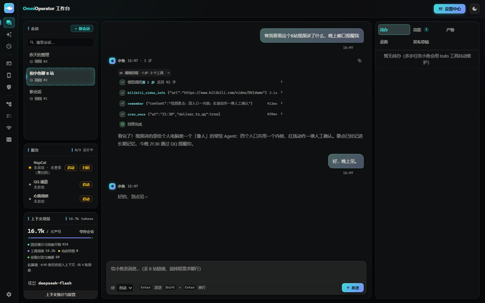

# OmniOperator · 小鱼

开发者入口：[本地 Agent 工程](agent/README.md) · [全仓目录规则](docs/REPOSITORY_STRUCTURE.md)。

[](LICENSE)
[](https://www.python.org/)
[](docs/INSTALLER.md)
[](docs/DEVELOPMENT_STATUS.md)
[](docs/ACCEPTANCE.md)

**跑在 Windows 上的常驻具身个人 agent**：QQ / Web 工作台 / CLI / 心跳四个入口共用一个内核——
能看 B 站并给出看后感、操作浏览器、控制安卓手机、跑命令、自维护长期记忆与技能。
Python 3.12+ · uv · LiteLLM 网关 · SQLite 记忆与运行账本 · 无前端构建（原生 ES 模块）。

> **状态（如实口径）**：受控内测（alpha）。全量离线测试通过；真实账号/设备/模型闭环与
> 72 小时常驻验收尚未全部完成；macOS/Linux 全功能、通用桌面接管、视频上传均**不属于已验证交付**。
> 开源不等于发布稳定版——对外发布仍需所有者按验收闸门明确批准。
> 本地运行不表示模型请求不出机：配置了云端模型密钥时，对话内容会发送给对应供应商。



## 安全模型

开源个人 agent 的第一问题是"它会不会乱来"。本项目把约束做在确定性代码里，不靠模型自觉：

| 约束 | 机制 |
|---|---|
| 三档审批 | 读操作 SAFE 直通；写操作 CONFIRM 必须人工确认；DANGEROUS 一律拒绝（shell 另有灾难级硬黑名单——**确认也不执行**） |
| 无人值守 fail-closed | 定时/心跳默认拒绝一切写操作；审批器缺省即拒绝；"结果未知"的写操作**永不自动重试** |
| 费用可控 | 每次模型调用先按"输入估算 + 输出上界"预留、事后按实际 usage 结算；每日/单次预算是硬拦截 |
| 隐私闸门 | 截图等产物默认只存本地；未显式开启 `vision.send_to_cloud` 时模型"看不到图"并如实说明，不假装看过 |
| 白名单 fail-closed | QQ 空白名单 = 拒绝所有人；私聊/群聊场景隔离，群聊不注入个人档案与常驻记忆 |
| 内容是数据 | 网页/记忆/常驻笔记一律按"不可信数据"处理——里面就算写着指令也不执行；权限始终由工具风险等级与审批器约束 |

完整契约（会话并发、至多一次领取、浏览器单线程所有权、文件域边界、产物归属……）见
[架构权威 ARCHITECTURE](docs/ARCHITECTURE.md) §3，由 `agent/tests/test_arch.py` 等测试强制执行。
安全漏洞请按 [SECURITY](SECURITY.md) 的渠道报告，勿在公开 issue 讨论细节。

## 能力一览

| 能力 | 当前实现与说明 |
|---|---|
| 内核 | 工具循环/grace call、todo、运行事件、取消、受限委派、持久摘要、费用预留与结算 |
| 记忆和技能 | 事实/档案/常驻记忆、作用域/额度/遗忘、异步 review、技能 CAS/历史/回滚、归档恢复、外来包隔离安装与待审阅差异；设置中心「技能」统一统计、导入、归档与配置 |
| 本机与网页 | 受限文件读写、只读 shell 白名单与人工确认命令、公开网页抓取、产物与有隐私开关的图像输入 |
| 调度与 QQ | cron 编辑/时区/成功运行依赖/并行限制、持久 outbox 与回执、群场景隔离；[QQ 场景](docs/QQ_SCENARIOS.md) |
| 浏览器与 B站 | Playwright 所有者线程、预算与审批；B站读四件套、评论/私信草稿与受控 UI 发送；[B站写入](docs/BILIBILI_WRITING.md)（默认关闭，实站选择器待核验） |
| 安卓 | 观察绑定动作、锁帧坐标、设备互斥、焦点核验/输入法恢复、MJPEG；[安卓手册](docs/ANDROID.md)（真机待验） |
| Windows 桌面 | 原生 UIAutomation、观察令牌、窗口租约、后台语义动作；[桌面手册](docs/DESKTOP.md)（记事本首个真实闭环通过，第二应用待验） |
| 插件与社区 | manifest/隔离/人工激活、命名空间工具注册、启停卸载、社区客户端与参考服务器；[插件手册](docs/PLUGIN_SYSTEM.md) |
| MCP | stdio、管理面板、schema 漂移撤权、人工确认；[MCP 手册](docs/MCP.md)（HTTP/OAuth 后置） |
| 混合检索 | Ollama/API embedding 双接口、sqlite-vec + FTS、异步索引与删除联动；[检索手册](docs/RETRIEVAL.md)（默认关闭，实际效果待评测） |
| 运维与验证 | 进程身份、有界关闭、只读 doctor、备份恢复、日志轮转、离线测试、证据与常驻检查；[运维](docs/OPERATIONS.md)、[验证](docs/VALIDATION.md)、[验收](docs/ACCEPTANCE.md) |

CLI 支持 `/new`、`/list`、`/use <id>`、`/switch <model>`、`/tools`、`/memory`、`/skills`、
`/doctor`、`/help`、`/quit`。工作台提供会话、运行进度与停止、审批、产物、技能编辑、
任务与待投递、服务、设备、用量和设置中心。

## 模块地图

以职责模块为单位（与 `agent/src/omni/system/catalog/schema.py` 分类一致，由
`agent/tests/test_community_docs.py` 守卫防漂移）。可搜索的完整索引见工作台 `/project/` 页与
[docs/index/MODULES.md](docs/index/MODULES.md)（由 `scripts/project_index.py` 自动生成）。

### 内核与模型

| 模块 | 职责 | 文档 |
|---|---|---|
| `assembly` | **运行时组装** — 唯一组装根，构造依赖并暴露 Runtime 门面 | [ARCHITECTURE](docs/ARCHITECTURE.md) |
| `prompt-context` | **提示词与上下文** — 稳定系统前缀、回合快照渲染与保留当前请求的摘要边界 | [PROMPT_CONTEXT](docs/PROMPT_CONTEXT.md) · [ARCHITECTURE](docs/ARCHITECTURE.md) |
| `engine` | **Agent 内核** — 回合、上下文、工具循环、取消、委派约束、review 与调度 | [ARCHITECTURE](docs/ARCHITECTURE.md) |
| `models` | **模型网关与 embedding** — 模型路由、能力、重试、流式、预算与 embedding 传输 | [RETRIEVAL](docs/RETRIEVAL.md) |
| `safety` | **审批与权限** — 风险分级、人工审批与无人值守拒绝 | [ARCHITECTURE](docs/ARCHITECTURE.md) |

### 工具能力

| 模块 | 职责 | 文档 |
|---|---|---|
| `toolkit` | **工具公共协议与兼容层** — Registry、ToolResult、SessionRef/RunRef、路径策略与截图协议 | [ARCHITECTURE](docs/ARCHITECTURE.md) |
| `personal` | **个人记忆工具** — 时钟、事实、档案、常驻、todo、摘要与手动整理 | [ARCHITECTURE](docs/ARCHITECTURE.md) |
| `scheduling` | **调度工具** — 周期/一次性任务、编辑、依赖和执行查询 | [HANDOFF](docs/HANDOFF.md) |
| `delegation` | **委派工具** — 受父预算/权限/取消约束的子任务 | [ARCHITECTURE](docs/ARCHITECTURE.md) |
| `system-tools` | **系统服务工具** — 状态查询和受审批的服务操作 | [OPERATIONS](docs/OPERATIONS.md) |
| `shell` | **Agent shell 工具** — 只读命令语法、执行器、硬黑名单与人工确认命令 | [ARCHITECTURE](docs/ARCHITECTURE.md) |
| `files` | **文件工具** — 允许根内的列表/搜索/读取/差异与受控写入回滚 | [ARCHITECTURE](docs/ARCHITECTURE.md) |
| `web-fetch` | **网页读取工具** — 公开网页的目标网络、重定向、体积限制与正文提取 | [ARCHITECTURE](docs/ARCHITECTURE.md) |
| `browser` | **浏览器工具** — Playwright 所有权、表单协议、观察与写预算 | [BILIBILI_WRITING](docs/BILIBILI_WRITING.md) |
| `android` | **安卓工具** — ADB、防护、UI 树、观察令牌、锁帧和输入法 | [ANDROID](docs/ANDROID.md) |
| `desktop` | **桌面工具** — Windows UIAutomation、窗口观察、租约与受控语义动作 | [DESKTOP](docs/DESKTOP.md) |
| `bilibili` | **B站工具** — 读 API/转写及注入浏览器协议的草稿与受控写 | [BILIBILI_WRITING](docs/BILIBILI_WRITING.md) |
| `qq-tools` | **QQ 工具** — OneBot 客户端与白名单内主动消息 | [QQ_SCENARIOS](docs/QQ_SCENARIOS.md) |
| `command-jobs` | **后台命令任务** — 审批后的独立命令任务、有限日志、会话隔离与取消 | [TERMINAL](docs/TERMINAL.md) |

### 插件与扩展

| 模块 | 职责 | 文档 |
|---|---|---|
| `plugins` | **插件宿主** — manifest、隔离校验、人工激活、插件注册与生命周期 | [PLUGIN_SYSTEM](docs/PLUGIN_SYSTEM.md) |
| `community` | **插件社区** — 社区客户端、工具适配与独立分发服务器 | [PLUGIN_SYSTEM](docs/PLUGIN_SYSTEM.md) |
| `skills` | **技能中心** — 技能编辑/历史/回滚、归档恢复、外来包隔离安装、统计与设置 | [SKILL_SYSTEM](docs/SKILL_SYSTEM.md) |
| `mcp` | **MCP 扩展适配** — 外部 stdio 工具发现、授权、漂移撤权与子进程生命周期 | [MCP](docs/MCP.md) |

### 交互与终端

| 模块 | 职责 | 文档 |
|---|---|---|
| `cli` | **CLI 入口** — 终端对话命令与 Runtime 适配 | [HANDOFF](docs/HANDOFF.md) |
| `qq-channel` | **QQ 入口** — QQ 场景队列、事件去重和消息收发适配 | [QQ_SCENARIOS](docs/QQ_SCENARIOS.md) |
| `heartbeat` | **心跳入口** — 定时领取、执行、投递与周期清理 | [OPERATIONS](docs/OPERATIONS.md) |
| `channels` | **入口公共适配** — 入口生命周期和只读诊断/检索评测命令 | [OPERATIONS](docs/OPERATIONS.md) |
| `terminal` | **内置终端** — ConPTY 后端、会话、会话池、WebSocket 四层；与 agent shell 工具分工 | [TERMINAL](docs/TERMINAL.md) |
| `web-ui` | **Web 界面与身份** — 工作台业务路由、统一鉴权与静态界面 | [ARCHITECTURE](docs/ARCHITECTURE.md) |
| `ui-shared` | **界面公共交互** — 统一导航、有界请求、反馈和确认框 | [UI_QA](docs/UI_QA.md) |
| `workbench` | **项目与能力工作台** — 项目索引、API、已注册工具和扩展状态的只读 HTTP 适配 | [PROJECT_INDEX](docs/PROJECT_INDEX.md) |

### Web 接口

| 模块 | 职责 | 文档 |
|---|---|---|
| `http-routing` | **HTTP 路由装配** — 聚合注入 Runtime 的领域路由，由应用入口统一挂载 | [PROJECT_INDEX](docs/PROJECT_INDEX.md) |
| `http-contracts` | **HTTP 请求契约** — 公共请求模型；只承载数据声明 | [PROJECT_INDEX](docs/PROJECT_INDEX.md) |
| `http-sessions` | **会话与待办 API** — 会话选择、历史、状态和待办 | [PROJECT_INDEX](docs/PROJECT_INDEX.md) |
| `http-context` | **上下文设置与统计** — 保留窗口、缓存样本、提示词指纹及配置保存 | [CONTEXT_SETTINGS](docs/CONTEXT_SETTINGS.md) |
| `http-conversation` | **对话与流式 API** — 普通/流式对话、显式运行入口 | [PROJECT_INDEX](docs/PROJECT_INDEX.md) |
| `http-runs` | **运行与用量 API** — 运行查询、事件续读、协作取消和费用视图 | [PROJECT_INDEX](docs/PROJECT_INDEX.md) |
| `http-memory` | **记忆与档案 API** — 事实、档案、常驻、review 和检索状态 | [PROJECT_INDEX](docs/PROJECT_INDEX.md) |
| `http-skills` | **技能与审阅 API** — 技能编辑/修订/差异/回滚和待审阅状态 | [PROJECT_INDEX](docs/PROJECT_INDEX.md) |
| `http-artifacts` | **产物 API** — 产物列表、指纹验证读取和清理 | [PROJECT_INDEX](docs/PROJECT_INDEX.md) |
| `http-approvals` | **审批 API** — 待批准事项和人工决定；不构造或绕过审批器 | [ARCHITECTURE](docs/ARCHITECTURE.md) |
| `http-mcp` | **MCP 管理 API** — 只读状态、显式发现、目录复核和重连 | [MCP](docs/MCP.md) |
| `http-operations` | **服务与诊断 API** — 系统概览、doctor、备份、服务启停和日志 | [OPERATIONS](docs/OPERATIONS.md) |
| `http-automation` | **调度与投递 API** — 任务创建/编辑/启停、历史和 outbox 人工处理 | [PROJECT_INDEX](docs/PROJECT_INDEX.md) |
| `http-publications` | **发布草稿 API** — 草稿查询、乐观编辑和未知结果核查，不直接发布 | [BILIBILI_WRITING](docs/BILIBILI_WRITING.md) |
| `http-capabilities` | **能力与诊断面板** — 被动诊断和能力汇总，不自动启动依赖 | [OPERATIONS](docs/OPERATIONS.md) |
| `http-android` | **安卓设备 API 与面板** — 按设备固定目标、配对归属的观察与受控应用操作 | [ANDROID](docs/ANDROID.md) |
| `http-devices` | **桌面与安卓 API** — 窗口观察、设备树/锁帧、受观察约束的手动动作和 MJPEG | [ANDROID](docs/ANDROID.md) · [DESKTOP](docs/DESKTOP.md) |
| `http-storage` | **项目目录与文件管理** — 全局与 Agent 目录设置及当前空间公开文件区 | [STORAGE](docs/STORAGE.md) |

### 平台与数据

| 模块 | 职责 | 文档 |
|---|---|---|
| `config` | **配置与路径契约** — 配置模型、加载与 RuntimePaths（全部可写路径的唯一声明） | [ARCHITECTURE](docs/ARCHITECTURE.md) |
| `storage` | **记忆与运行账本** — 会话/事实/技能/产物及 state.db 事务、迁移、额度、投递 | [OPERATIONS](docs/OPERATIONS.md) |
| `platform` | **平台基础设施** — 服务、进程身份、配置写回、锁/原子文件、日志、doctor、备份与验收 | [OPERATIONS](docs/OPERATIONS.md) |
| `agent-directories` | **项目存储与 Agent 目录** — 全局与独立空间目录解析、CAS 配置与用途索引 | [STORAGE](docs/STORAGE.md) |
| `command-contracts` | **命令账本声明** — state.db 命令账本的纯迁移声明 | [TERMINAL](docs/TERMINAL.md) |

### 开发与验证

| 模块 | 职责 | 文档 |
|---|---|---|
| `catalog` | **项目索引基础设施** — 只读 AST 扫描、分类和确定性文档生成 | [PROJECT_INDEX](docs/PROJECT_INDEX.md) |
| `package` | **Python 包入口** — 安装包标识 | — |

## 快速开始

### 一键图形安装器（推荐）

双击仓库根目录的 `install.bat` 打开**图形安装器**，点「开始安装」；完成后点「启动工作台」
（或双击 `start.bat`），浏览器会自动打开配对链接。模型密钥、QQ 白名单、B站 Cookie 等
全部在工作台「设置中心」完成，安装器不碰任何密钥。镜像选项、失败降级与手动方案见
[安装器手册](docs/INSTALLER.md)。

### 手动安装（等价步骤）

```powershell
# 首次安装；常驻服务占用 .venv 入口时，先按运维手册安排维护窗口。
uv sync --frozen
# 使用浏览器能力时安装 Chromium。
uv run python -m playwright install chromium

# 复制配置模板并填写：
Copy-Item .env.example .env                      # 模型密钥（至少配一家，见文件内说明）
Copy-Item config\config.example.yaml config\config.yaml   # 运行配置（QQ 白名单等，本地文件不入库）

uv run omni-web        # Web 工作台：控制台打印配对链接，点开即完成本机配对
uv run omni            # CLI（REPL）
uv run omni-qq         # QQ 通道（需先部署 NapCat，见 docs/QQ_SETUP.md）
uv run omni-heartbeat  # 定时调度（无人值守 fail-closed；写操作仍受审批约束）
```

常驻主环境需要避免 uv 同步时，按[运维手册](docs/OPERATIONS.md)使用 `uv run --no-sync …`；
不要为了跑测试停止用户服务。付费/无人值守能力启用前，先在设置中心明确模型预算与权限。

## 配置要点

- **模型密钥**：`.env`（参考 `.env.example`，国产/海外供应商前缀与 LiteLLM 对应）；本地 Ollama 免密钥。
- **QQ**：部署 [NapCat](docs/QQ_SETUP.md) → 工作台扫码 → 设置白名单（空白名单 = 谁都不许）。
- **B站**：Cookie 在工作台设置中心粘贴（默认关闭写入；[写操作手册](docs/BILIBILI_WRITING.md)）。
- **安卓**：USB 调试 + ADB + 中文输入法适配，见[安卓手册](docs/ANDROID.md)（真机待验）。
- **MCP**：显式配置的本地 stdio 服务，见 [MCP 手册](docs/MCP.md)。
- **数据与验证**：配置在 `config/config.yaml`（本地文件，不入库），凭据在 `.env`；
  `data/memory.db` 存会话与记忆，`data/state.db` 存任务/额度/运行账本；路径均可注入。


```powershell
uv run --no-sync pytest -q                          # 全量离线测试（禁止真实付费/社交/设备动作）
uv run --no-sync python -m omni.channels.doctor    # 只读体检
uv run --no-sync python -m omni.system.backup --to data/backups/<日期>   # 升级前备份
```

## 开发接手（贡献者入口）

1. 先读 [HANDOFF](docs/HANDOFF.md)（交接入口：能力清单 + 平台坑），再读
   [ARCHITECTURE](docs/ARCHITECTURE.md)（分层与组装根唯一权威，`agent/tests/test_arch.py` AST 强制）。
2. 进度与证据以 [DEVELOPMENT_STATUS](docs/DEVELOPMENT_STATUS.md) 台账为准；
   功能导航见 [PROJECT_INDEX](docs/PROJECT_INDEX.md)。
3. 新能力接入（工具/通道/记忆/插件）按 [ARCHITECTURE §5](docs/ARCHITECTURE.md) checklist 走；
   每个新模块必须有单测，提交信息用中文「领域：要点——细节」，全量测试全绿再提交。
4. 前端纪律以 [UI_DESIGN_SYSTEM](docs/UI_DESIGN_SYSTEM.md) 为唯一规范；新增/删除文件后跑
   `uv run --no-sync python scripts/project_index.py` 更新索引。
5. 完整贡献流程见 [CONTRIBUTING](CONTRIBUTING.md)；参与即接受
   [行为准则](CODE_OF_CONDUCT.md)。

## 文档地图

完整导航（含每份文档的一句话说明）见 [docs/README.md](docs/README.md)：

- **用户手册**：[安装器](docs/INSTALLER.md) · [QQ 部署](docs/QQ_SETUP.md) · [QQ 场景](docs/QQ_SCENARIOS.md) ·
  [B站写入](docs/BILIBILI_WRITING.md) · [安卓](docs/ANDROID.md) · [桌面](docs/DESKTOP.md) ·
  [MCP](docs/MCP.md) · [终端](docs/TERMINAL.md) · [存储](docs/STORAGE.md) · [检索](docs/RETRIEVAL.md) ·
  [插件系统](docs/PLUGIN_SYSTEM.md)
- **开发者文档**：[架构权威](docs/ARCHITECTURE.md) · [项目导航](docs/PROJECT_INDEX.md) ·
  [提示词上下文](docs/PROMPT_CONTEXT.md) · [UI 设计系统](docs/UI_DESIGN_SYSTEM.md) ·
  [重构记录](docs/REFACTORING.md) · [运维](docs/OPERATIONS.md) · [验证](docs/VALIDATION.md) · [验收](docs/ACCEPTANCE.md)
- **内部开发台账**（如实记录，不代表发布状态）：[交接文档](docs/HANDOFF.md) ·
  [开发台账](docs/DEVELOPMENT_STATUS.md) · [完整计划](docs/LOCAL_AGENT_PLAN.md) ·
  [开发大纲](docs/DEEPSEEK_DEVELOPMENT_OUTLINE.md) · [能力完善记录](docs/CAPABILITIES_PLAN.md) ·
  [UI QA](docs/UI_QA.md) · [自动生成索引](docs/index/MODULES.md)

## 路线图与状态（如实）

D00–D27 与 C01–C06 代码侧已交付，前端已完成统一改造（一套 token/组件库/ES 模块）。
**真实账号/设备/模型闭环、72 小时常驻、通用桌面接管、视频上传仍待验收**；已交付能力的
边界与证据逐项见 [DEVELOPMENT_STATUS](docs/DEVELOPMENT_STATUS.md)，发布闸门见
[ACCEPTANCE](docs/ACCEPTANCE.md)——发布通过也仍需所有者明确批准。版本级能力记录见
[CHANGELOG](CHANGELOG.md)。

## 许可与使用边界

代码以 [Apache-2.0](LICENSE) 许可发布。

使用边界（请务必阅读）：

- QQ/B站等第三方平台自动化存在**平台条款与风控风险**：账号冻结、限制等后果由使用者自行承担；
  请用小号试水，本项目不担保账号安全。
- 拟人延迟、写预算、人工审批是降低风险的设计，**不是**绕过风控的承诺。
- 无人值守场景一律 fail-closed；花钱、发布、群发、加好友必须人工确认——请保持这些默认值。
- 本项目面向个人本地使用与学习研究；请遵守所在地区法律与各平台服务条款。

## 开发目录入口

本地 Agent 的完整工程位于 [agent/](agent/README.md)：源码、测试、配置模板、开发脚本和产品依赖均归该目录。全仓位置规则见 [REPOSITORY_STRUCTURE](docs/REPOSITORY_STRUCTURE.md)。安装与旧命令兼容在根 scripts/；真实配置、记忆、资料和运行日志保持既有路径。
