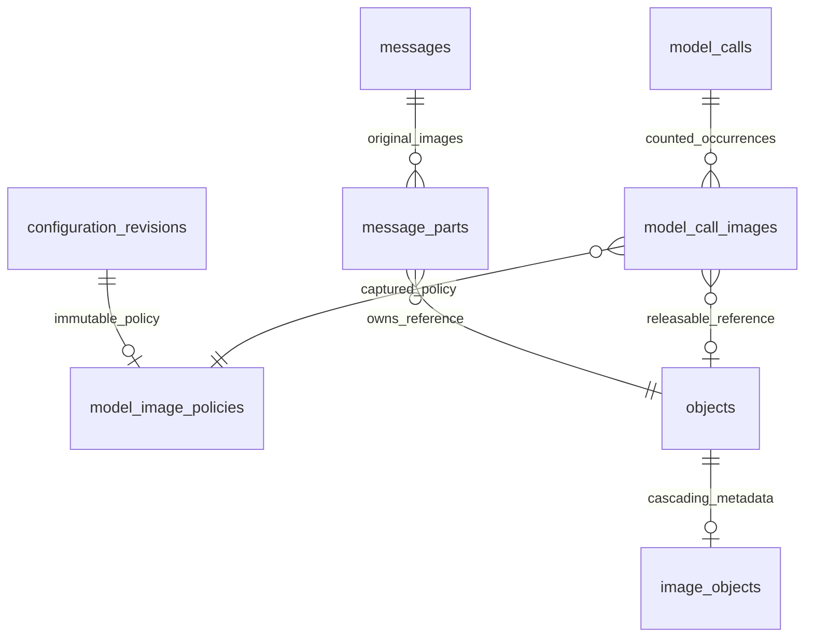
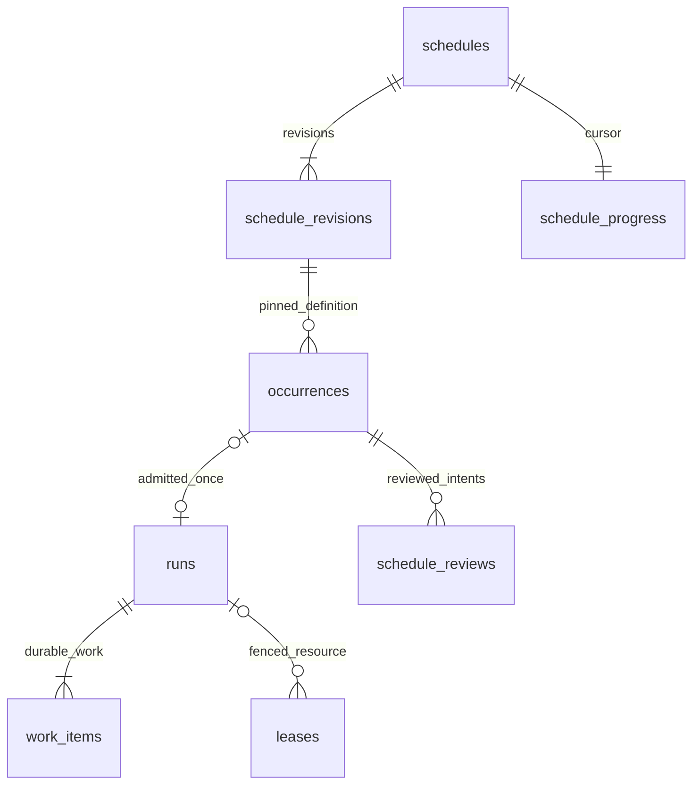

# OmniOperator 数据模型总览

> V2的新单库模型及迁移状态见 [V2实施记录](V2_REFACTOR.md)。下文两库合同仅适用于仍保留的V1；新库不会导入旧数据。

## V2 技能修订与一次封存目录

当前 **125张业务表，迁移头`v2_0035`**。复用`skill_revisions`主文档对象，新增`skills/skill_manifests/skill_files/run_skill_catalog/run_skill_activations`，目录与实际使用分离，内容和参考文件只保存在现有对象。`runs.skill_capture_epoch`一次封存，历史运行不补造授权；启用审阅同时由技能头和捕获目录的真实审计外键保留。更新/归档/停用提升代次并取消待派发审批，恢复停用已启用项并记录审计；未知动作和费用不改写。详见[技能合同](V2_SKILLS.md)。

## V2 记忆派生向量与相关关系

记忆语义批次基线为120张业务表/v2_0034，当前版本见文首。`memory_embeddings`保存源修订/指纹、模型版本/维度、启动所有者及可清空向量；`memory_semantic_batches/sources/links`规范化固定选择、作用域、恢复代次及可逆人工关系，首次核查/撤销分别通过真实审计外键保护。正文和来源仍在原记忆模型，恢复只失效派生记录而不重写真值；SQL约束和失效触发器阻止旧计算再发布。语义关系不参与精确重复抑制谓词，详见[记忆语义合同](V2_MEMORY_SEMANTICS.md)。

## V2 档位修订与调用清单

档位批次基线为116张业务表/v2_0033，当前版本见文首。新增`model_route_policies`、`run_routes`、`route_changes`、`model_call_routes`和`model_call_route_tools`，分别保存不可变策略、初始选择、唯一升档、调用顺序/规格指纹和具体工具。组合外键及触发器核验Agent、捕获模型、预留、运行状态及真实提供控制工具的来源；旧V2仅回填原模型的完整档基线。费用仍在原账本，摘要/历史无快照明确显示，不复制消息、工具参数/结果或另建费用真值。详见[档位合同](V2_ROUTING.md)。

## V2 本地向量身份与派生索引

向量批次未新增表，其基线为111表/v2_0032，当前版本见文首。真实本地向量继续使用document_index_builds/document_vectors及来源修订的活动指针，版本包含包指纹、池化/前缀/分窗、CPU及固定运行时，维度沿原约束。查询只比较相同版本/维度，来源修改或删除使在途构建invalidated；错误不能发布新的活动索引。模型包与本机选择是安装材料，不属于第二套业务数据库；启动审计记录实际选择版本和状态，原文只保存在现有对象来源。详见[向量合同](V2_LOCAL_VECTORS.md)。

## V2 图片引用与非拥有元数据

图片批次基线为111表/v2_0032，当前版本见文首。`message_parts.kind=image`与原始用户消息、运行和入站去重原子登记；原消息入队后不能补写图片。`image_objects`只保存实际格式和尺寸，为唯一不构成保留拥有权的对象外键，采用ON DELETE CASCADE；消息与调用引用仍阻止回收。`model_image_policies`固定模型配置修订、协议、单次与累计上限及指纹，不能在已捕获运行之后追加或改写。`model_call_images`绑定调用、上下文快照、原消息/分块、策略及对象指纹；状态与模型调用统一结算。删除来源清空对象指针和登记删除时间，保留预算事实；调用记录不可删除来重置额度。组合外键、范围/状态/预算触发器约束跨Agent及生命周期。详见[图片合同](V2_IMAGES.md)。

## V2 模型流式记录

流式模型继续使用`model_calls/budget_accounts`预留和一次结算，最终消息/运行/投递仍沿原事务提交。片段为活跃运行的有界内存预览，不进入messages、run_events或诊断存储；缺少供应商原始用量保留unknown，SDK补算不释放预留。模型调用捕获并重查配置及凭据revision/authority_epoch。流式批次本身未增加迁移；图片消息与实际附图来源现已沿本文模型并入单库。详见[流式合同](V2_MODEL_STREAMING.md)。

## V2 安卓输入法恢复

`android_unicode_profiles`按根设备授权追加配置，revision单步递增且不可修改/删除，只保存凭据引用和组件指纹。`android_unicode_environments`以唯一action_id记录原IME/subtype、启用集合指纹、原设备/端点及恢复观察；组合外键、来源与状态触发器约束同Agent、同设备和实际批准动作。原捕获不可改写，pending义务阻止相同设备新输入；恢复不修改原输入unknown。正文和输入结果仍在共享actions，不产生第二套真值。详见[Unicode合同](V2_ANDROID_UNICODE.md)。

## V2 安卓模型运行范围

`android_access`固定运行、批准动作、设备授权、会话代次、策略和期限；`android_access_packages/kinds`以不可改写的关系行保存范围、唯一约束和Agent外键，不以JSON作为权限判定真值。使用时重算范围指纹，并要求来源动作完成；unknown来源、撤权、恢复/会话代次及到期均拒绝。审批、动作结果、费用和核查仍沿共享账本，详见[模型范围合同](V2_ANDROID_MODEL.md)。

## V2 安卓设备授权

`android_grants`固定Agent、配置修订、序列号/transport/boot/Android用户/构建指纹及历史代次，具有作用域外键、指纹与revision约束；触发器只允许撤销，恢复历史代次变化要求重新授权。所有者安卓动作继续使用`owner_commands → actions`单向移交，不复制正文或新建审批/结果真值。`session_captures`增加`adb_screencap`来源，沿统一会话对象引用及删除传播。详见[安卓合同](V2_ANDROID.md)。

## V2 会话截图对象

当前表数和迁移头以文首为准。`owner_commands`按Agent+请求UUID去重，固定内容指纹、启动身份、运行与会话内容代次。入队时参数只在该表保存，审批动作建立时原子转入`actions`并清空命令参数。绑定不可改写，取消、来源失效或重启清除未移交正文；重启中断旧启动排队命令，不重放历史窗口操作。

`runs.execution_kind`固定为`model/owner`，默认模型运行。数据库分别校验模型配置与所有者设置快照，类型不能修改；所有者命令不能取得模型调用授权，也不能派发聊天投递。原有V2运行升级后仍为model，新类型与空模型配置不混淆。审批、执行、费用、unknown核查仍沿用原账本。

`v2_0024`统一Windows/Mac/X11来源，`v2_0025`扩充为`print_window / screen_capture_kit / x11_composite / pipewire_window`，不增加业务表。迁移按事务重建该表并重建现有触发器；中断回滚，旧引用、组合外键及禁止改写保持有效。来源类型表示采集路径，不代表平台真实验收已通过。

`session_captures` 是已保存截图的引用真值，固定 Agent、会话、对象、操作 UUID、内容代次、尺寸和采集方式。图片只在内容寻址对象中保存一份，审计只记录元数据。引用以组合外键隔离 Agent，操作身份唯一且记录不可改写；登记时要求有效会话及相同内容代次。对象注册、引用及审计在同一事务提交。

列表按 UUID 稳定分页；显式移除截图或删除整个会话释放引用，普通消息删除不删除独立截图。引用自动纳入对象 GC 和验证备份。窗口临时观察不成为永久授权，图片不会自动成为模型附件。

## V2 B站发布与规则修订

`bilibili_profiles`绑定通道配置和当前规则修订，`bilibili_profile_revisions`保存不可变的选择器/浏览器模式；`bilibili_publications`引用原消息、配置及规则修订，固定目标、内容指纹和mention字符锚点，禁止相同语义绕过请求key重复准备。`bilibili_deliveries`把发布与共享outbox关联，不新增发送状态真值。正文仅在messages，显示名从原文导出，权限撤销与删除传播复用统一来源/上下文判定。详见[B站合同](V2_BILIBILI.md)。

## V2 QQ通道与人物归属

`qq_bindings`为Agent内人工创建的会话授权，绑定统一通道配置、独立会话、私聊/群聊目标、独立人设、修订和持久入站冷却；更换目标须新建授权。`qq_runs`关联统一运行、配置及授权修订、发送者人物与人工账号绑定，固定事件去重键和内容指纹，不重复消息正文，来源不可改写。账号绑定ID保留为历史身份而不建立阻止解绑的外键，授权时仍核验其存在和人物归属。跨Agent关系使用作用域外键。

正文、上下文、费用和投递沿用统一账本。QQ输出与待审批outbox原子提交，发送冷却复用投递尝试时间；不另建QQ费用库或消息真值。QQ会话不捕获所有者记忆或全局工具，关闭和取消沿统一生命周期。详见[QQ合同](V2_QQ.md)。

## V2 所有者终端模型

终端批次基线为95张声明业务表、`v2_0024`，当前以文首为准。`terminal_sessions`固定Agent、启动身份、Shell、目录指纹、权限代次、原生创建身份与生命周期；`terminal_operations`固定每个操作的ID、种类、意图指纹、字节数、状态与审计外键。输入和输出正文不写入两表。操作结果从`prepared`一次结算为`accepted/not_sent/unknown`，同ID回查不再次派发，终态回执不能改写；`accepted`不表示命令成功。已退出或未知会话不能复活，已知退出码不可覆盖。

清理回收必须有当前启动持有的真实进程证明，辅助进程退出和历史PID都不足以作证。恢复和重启保留原身份，将未完成操作隔离为未知；`doctor`分别统计活跃终端、待核查会话与未知操作。终端意图审计使用真实外键纳入保护，关闭并不删除证据。详见[终端合同](V2_TERMINALS.md)。

## V2 未知动作核查模型

动作核查批次基线为95张表、`v2_0024`，当前以文首为准。`action_review_heads`保存每个动作的当前核查修订、历史代次、会话内容代次、原参数/结果指纹及当前结论；`action_reviews`保存不可变所有者观察、精确来源证明和受保护的审计外键；`action_review_evidence`只保存可擦除的核查依据正文。三个结论为`applied / not_applied / still_unknown`；前两个可解除动作自身的未知保护，不能改变原执行unknown、费用、投递或重新派发。

核查仅接受终态运行中已结束的未知写动作。提交绑定核查ID、revision、history_epoch、fingerprint及政策，重复同请求只返回回执。跨Agent与动作/运行归属使用组合外键；原始未知动作身份和效果、核查账本禁止重写。来源会话删除使当前头失效并清空依据正文，保留指纹；合法正文裁剪保留已核查证明。恢复创建新历史代次、失效所有当前结论，历史账本继续保留。查询有界分页，普通HTTP不返回原动作正文。

> 本文回答「每张表在哪、归谁管、什么时候清理」。分层与依赖规则以
> [ARCHITECTURE.md](ARCHITECTURE.md) 为唯一权威；目录与磁盘布局见 [STORAGE.md](STORAGE.md)。
> 声明与实现分离是本轮重构（2026-10-31）的硬约束：**表结构只在声明模块出现，
> 行为只在仓储模块出现**，守卫测试防止本文与真实 DDL 漂移。

## V2 持久调度模型（独立omni.db）

动作核查结论`applied/not_applied`解除该动作的未知阻塞，既有启用计划若无其他阻塞，可恢复未来到期调度；旧动作和旧回合不重发。`still_unknown`继续阻塞。计划中的独立续跑确认仅接受风险继续未来调度，不等于核清过去动作，也不解除正文与审计保护。未实际完成的pending/approved/executing动作不能用续跑确认放行。

当前声明95张表、Alembic v2_0024。`schedules`保存当前头；`schedule_revisions`保存不可变定义与专用会话；`schedule_progress`保存下一到期时间、高水位、CAS版本、错误及核查显示序号；`occurrences`以计划+UTC到期身份及计划+序号唯一，固定来源修订，至多关联一个运行。`schedule_reviews`逐条引用模型调用、动作或投递记录及被核查状态，保留审计指纹及核查代次；恢复时提升代次、保留旧记录，显示序号不用于宽泛放行。全部跨Agent引用通过组合外键约束。

`work_items.queue_sequence`由实例计数器事务内分配且不可改写，turn工作项区分pending/claimed/running及终态；`leases`保存资源、启动身份、执行令牌、单调fence、到期时间和持有状态。租约过期不会把尚未结束的运行自动交给其他执行者。领取与运行开始分离，使重启时能明确区分尚未执行和无法确认的外部副作用。来源文档及历史批次详见[V2记录](V2_REFACTOR.md)，下文仍为V1两库说明。

V2持久投递：`outbox`只引用助手消息正文，固定来源epoch、正文/意图指纹、配置修订、账号、目标及适配器；`delivery_approvals`保存精确审批，`delivery_attempts`保存每次执行令牌/启动身份/fence，`delivery_results`保存不可变观察与迟到标记，`delivery_reviews`保存人工依据及恢复代次，`dispatch_resources`保存跨Agent的账号独占资源。意图唯一键与全局队列序号持久化；`revision`用于编辑CAS，`outcome_revision`仅在实际结果变化时增加，调度核查固定后者，归档不能使核查失效。外部发送在事务外发生，未知不重发，开始发送后的取消不释放仍在运行的本地资源。正文不在投递表重复保存。升级只处理既有V2开发库，不导入V1数据。

## 1 两库分工

| 库 | 文件 | 定位 | 连接实现 |
|---|---|---|---|
| memory.db | `data/memory.db` | 对话与记忆（长期资产，用户关心内容） | `memory/store.py::MemoryStore`（RLock + WAL） |
| state.db | `data/state.db` | 运行状态（短生命周期账本、跨进程协调） | `memory/state.py::StateStore`（显式事务 + mixin） |

跨进程互斥、至多一次、原子额度只能靠 SQLite 事务，因此全部运行协调表都在
state.db；对话原文、事实、技能、档案等"丢了用户会心疼"的数据在 memory.db
或文件（skills/、MEMORY.md、产物文件）。

## 2 state.db（声明唯一来源 `memory/state_schema.py`）

运行入口 `StateStore` 只保留连接/WAL/事务原语、schema 迁移、旧 JSON 导入与
健康检查；域方法由三个 mixin 提供；各领域门面只消费注入的 `_tx/_read`。

### 任务与账本

| 表 | 引入版本 | 归属模块 | 生命周期 |
|---|---|---|---|
| `jobs` | v1 | `state_mixin_jobs.py`（JobsMixin） | 用户删除时清理；`cron_outputs` 同事务删除 |
| `job_claims` | v1 | `state_mixin_jobs.py` | TTL 过期滚动清理（领取时顺带删除过期行） |
| `executions` | v1 | `state_mixin_ledger.py`（LedgerMixin） | 滚动保留最近 200 条 |
| `budgets` | v1 | `state_mixin_ledger.py` | 按 (scope, day) 自然滚动；损坏迁移时 fail-closed |
| `cron_outputs` | v11 | `memory/cron_store.py::ExecutionLog` | 任务链真值；`remove_job` 同事务删除 |
| `migrations` | v1 | `state.py`（迁移域） | 幂等记录，只追加 |

### 运行、模型账本与产物

| 表 | 引入版本 | 归属模块 | 生命周期 |
|---|---|---|---|
| `runs` / `run_events` | v4 | `memory/runs.py::RunStore` | 事件按 run 单调 seq；重启对账 interrupted |
| `llm_calls` / `llm_budget` | v5 | `memory/usage.py` | 费用流水与当日预算；`cost_micro=NULL` 表示未知，不是 0 |
| `llm_budget_scope` / `llm_budget_alert` | v15 | `memory/usage.py` | 分口径（= 通道）用量与提醒落盘；口径账与总额账并列，提醒权按 (日,口径,档位) 唯一，跨进程只发一次 |
| `artifacts` | v6 | `memory/artifacts.py` | `expires_at` 到期由心跳清理；活跃 run 引用不删 |

### 投递与外部能力

| 表 | 引入版本 | 归属模块 | 生命周期 |
|---|---|---|---|
| `outbox` | v7/v10 | `memory/outbox.py::OutboxStore` | 活跃行（pending/sending/unknown）绝不删；终态滚动保留 200 条 |
| `mcp_schemas` | v8 | `memory/mcp_schemas.py::MCPSchemaStore` | 指纹漂移撤权；用户复查后确认 |
| `skill_acks` | v9 | `memory/skill_acks.py::SkillAckStore` | 只前进不后退；技能归档时删除 |
| `qq_messages` / `qq_sent` | v12 | `memory/qq.py` | 去重保留 30 天；容量耗尽拒绝新事件 |
| `publication_drafts` | v13 | `memory/publications.py` | 发布红线账本；unknown 不自动二次发布 |
| `command_jobs` | v14 | `memory/command_jobs.py::CommandJobStore` | 任务终态 + 进程身份；恢复演练覆盖 |

### 基础设施

| 表 | 引入版本 | 归属模块 | 说明 |
|---|---|---|---|
| `meta` | 基础 | `StateStore` | schema 版本等元数据 |
| `resource_leases` | v3 | `state_mixin_leases.py`（LeasesMixin） | TTL 到期自动可再领；崩溃不需人工解锁 |

## 3 memory.db（声明唯一来源 `memory/store_schema.py`）

| 表 | 归属模块 | 说明 |
|---|---|---|
| `sessions` / `messages` / `message_contexts` | `memory/store.py::MemoryStore` | 会话与消息；回合快照随消息同事务 |
| `facts` / `tombstones` | `memory/store.py` | 事实与遗忘墓碑；FTS 触发器维护索引。`facts.hits/last_used` 是召回命中计数（30 分钟冷却 + 每天最多一次，`touch_facts` 原子条件更新），只参与召回重排、不做入场券 |
| `profile` | `memory/store.py` | 用户档案（2000 字符限额） |
| `reviews` / `review_runs` | `memory/store.py` | 回合后整理账本与区间去重 |
| `bindings` | `memory/store.py` | 通道用户 ↔ 会话绑定（QQ 等） |
| `todos` | `memory/store.py` | 会话级待办 |
| `summaries` | `memory/store.py` | 持久压缩摘要（区间唯一） |
| `meta` | `memory/store.py` | FTS 分词器版本等 |
| `dialogue_log` | `memory/dialogue.py` | M2 全量对话流水 |
| `session_log` | `memory/session_log.py` | 会话/运行/工具过程流水 |
| `journal_notes` / `journal_runs` | `memory/journal.py` | 每日整理素材 |
| `people` / `person_accounts` / `person_entries` / `owner_migration` | `memory/people.py` | 人物档案与所有者迁移标记 |
| `fact_vectors` | `memory/vectors.py` | sqlite-vec 向量（默认不启用） |

FTS 虚表（`facts_fts` / `messages_fts` / `dialogue_fts` / `session_log_fts`）
随宿主表在各自模块声明，由触发器维护。

`facts.evidence/source_ref`保存后台整理已逐字验证的来源摘录与指针；历史空值明确表示未验证来源，
不补造出处。review与journal写入共用anchor_scope，普通对话未提供可验证上下文时不接受模型自报出处。
遗忘通过当前scope内归一化后的同一句话匹配全库，不依赖FTS前八名；墓碑和向量删除仍在原事务执行。
后台混合召回不计hits，前台召回按注入时钟验证30分钟冷却与每日上限。

人设预设在RuntimePaths.persona_presets（`data/persona_presets.json`）以文件锁、revision和原子写持久化，
纳入备份恢复；导入预设不会应用运行人设，应用只填编辑草稿，保存才写配置并显示重启需求。
远程MCP凭据在RuntimePaths.mcp_credentials，使用当前Windows用户DPAPI保护，不进入普通配置或脱敏导出。

## 4 跨库关系与纪律（2026-11-01 实测清单）

**真值方向**：`session_id` 的真值是 memory.db 的 `sessions.id`；state.db 只存
id、不存内容、不级联（SQLite 跨库无外键）。**memory.db 的会话只增不减**
（`MemoryStore` 无会话删除方法），因此这些 id 永远有真值可指，删除清理路径
问题当前不存在。

state.db 引用 `session_id` 的表（从 DDL 动态提取，守卫测试校验本文不漂移）：

| 表 | 引用形态 | 归属校验点 |
|---|---|---|
| `runs` | 列 `session_id` | `RunStore.list_recent(session_id=…)` 过滤 |
| `llm_calls` | 列 `session_id` | 用量统计按会话聚合（`context_cache_usage` 等） |
| `artifacts` | 列 `session_id` | `ArtifactStore.get/list` 跨会话读取显式拒绝（`cross_session`） |
| `publication_drafts` | 列 `session_id` | `claim` 校验会话 + 内容哈希，不匹配拒绝 |
| `command_jobs` | 列 `session_id` | `CommandJobStore.get/list` 会话过滤，跨会话 404 语义 |
| `resource_leases` | **软引用**：键 `session:<id>` 字符串 | TTL 到期自动失效，无清理路径 |

其余 state.db 表（outbox 按 target_qq、qq_messages 按 bot+scene、cron_outputs
按 job）均不引用会话 id，跨库无关。

**是否合并两库（评估结论：不合并）**：
- 全部跨库消费都是「同一 session_id 分别查两个库」的应用层模式，**没有一条
  SQL 需要跨库 JOIN**（`grep` 核实各域模块）。
- 合并的收益（外键、JOIN）为零；代价是单库膨胀、备份粒度变粗（对话记忆与
  运行账本被迫一起备份/恢复）、WAL 写竞争加剧（心跳高频写 state.db，对话写
  memory.db）。保持两库。
- 新表如果将来要存 `session_id`，必须遵守：真值在 memory.db、不级联、写入
  前后不需要读 memory.db（校验归属靠应用层传入的 id）。

其余纪律：
- **金额口径**：`llm_calls.cost_micro` 一律微美元整数；`NULL` 是"算不出来"，
  `0` 是"确定免费"，两者不得混用。
- **状态语义**：`unknown` 永远表示"副作用未知"，不自动重试、不自动当成失败。
- **迁移纪律**：已发布版本（v1–v15）的 SQL 逐字节不变；新结构一律追加版本号，
  搬数据或删旧表的版本必须在 `state_schema.py` 注释里写清语义。迁移要**可重放**
  （版本回退后再前滚是运维手段），所以建表用 `CREATE TABLE IF NOT EXISTS`。

## 5 后续演进

1. 新表接入顺序：`state_schema.py` 声明 → 新版本号迁移 → 归属模块实现 →
   本文档登记 → 守卫测试通过。
2. 新增含 `session_id` 的表时，§4 清单与 `test_data_model.py` 的守卫会同时
   校验——漏登记文档会直接测试红。
3. 守卫测试（`agent/tests/test_data_model.py`）保证本文的 state.db 表清单、
   session_id 引用清单与真实 DDL 一致；改表必须同步改文档。

## V2对象与引用合同

本节仅适用独立V2的omni.db；对象批次基线为41张业务表、结构版本v2_0004，当前版本见本文开头。旧两库不导入。

| 实体/关系 | 真值及约束 |
|---|---|
| objects | 完整UUID与agent_id，Agent内SHA256唯一，非负大小；MIME、固定、到期及正整数revision |
| message_parts.object_id | 消息多模态引用，包含Agent的组合外键；当前工作台上传尚未进入模型消息 |
| source_anchors.object_id | 来源对象引用，受记忆来源及作用域约束；文档事实提取流程待接入 |
| skill_revisions.object_id | 技能内容修订引用，完整技能工作流待接入 |
| action_objects | 动作结算产物引用，action_id/object_id唯一，两侧包含Agent的组合外键 |

文件存放在objects/<agent_uuid>/<sha256前两位>/<sha256>.blob，同一Agent相同内容去重，跨Agent独立物理存放。上传发布后才登记，原始文件名不是路径真值。固定和引用优先于到期，不会因过期删除被引用对象。未固定且无引用对象默认24小时后可由显式停机计划回收。

回收先在事务中删除符合条件的元数据并记录审计，再清理文件；中断只允许留下可核查的未引用文件，不允许让引用悬空。回收计划、执行状态及指纹在当前实例控制目录持久保存，旧意图不能删除后来重新登记的同内容对象。未来新增对象外键会自动参与保护。

分页按完整对象UUID排序并带after游标，每页最多200条。固定变更要求revision，拒绝陈旧覆盖。快照必须包含数据库登记的全部对象并验证指纹；临时文件、未登记文件、凭据、浏览器状态和诊断日志不纳入普通业务快照。

## V2人物、档案与常驻记忆合同

| 实体/关系 | 真值及约束 |
|---|---|
| people | 每个Agent各有一个人物代表实例的同一所有者，唯一(agent_id, owner_id)；身份不可换绑，所有者不能删除或降为普通人物；普通人物软删除并清空名称 |
| accounts | Agent内(channel, external_id)唯一；关联到同Agent的存活人物，不自动转移已有绑定；当前仅支持人工记录，不授予所有者认证权限 |
| memory_entries | profile/resident各自每人仅一个存活条目，必须关联人物且不属会话，最多8000字符；与事实共同使用修订、来源和墓碑 |
| memory_revisions / source_anchors | 来源指向确定修订；组合外键同时绑定修订、条目及Agent，不能引用另一条记忆的修订。人工编辑关联审计；导入来源关联校验过的UTF-8文件对象 |
| context_memories | 替代快照中无约束的memory_ids数组，关系外键记录实际登记的条目与修订；旧V2快照缺失修订时标为legacy_unresolved，不能补造模型曾看到的版本 |
| tombstones / tombstone_sources | 保存归一化内容及来源的域分离SHA256，不保存原文。阻止模型重新写入相同指纹的正文或来源摘录；所有者显式重新编辑可以创建新条目 |

档案与常驻只有人物工作台一个编辑入口，普通记忆列表和检索不再混入这些文档。Markdown仅用于导入、导出与展示，不是第二份真值。文档保存同时核验条目UUID和revision，防止清空后重新创建导致旧草稿覆盖。修订历史有界分页，每个修订显示自身来源。

运行准备登记消息与所有者文档的确定修订。普通编辑供新运行使用，已有运行保留捕获修订；来源遗忘使受影响的活跃运行停止，已发出的模型请求无法撤回，返回后也不能发布旧回复。运行上下文接口展示“已登记”，不等同于供应商已经接收。其他人物档案不会自动注入所有者上下文。

遗忘在同一事务清空条目与全部历史修订正文、删除来源摘录及其对象引用、更新全文索引并写入墓碑和审计。人物删除将其全部记忆及账号一并处理，任一步失败整体回滚。上下文保留修订关系以说明已遗忘，不保留另一份正文；源消息或源文件本体不会因此被暗中删除。摘要和已登记来源的派生事实已接传播；未来向量、来源文档及后台整理仍需接入。

## V2摘要、上下文与删除边界

| 实体/关系 | 真值及约束 |
|---|---|
| sessions.content_epoch / context_floor_seq | 正整数删除版本、非负且不超过next_seq的历史边界；遗忘时在同一事务更新，追加新消息不改删除版本 |
| summaries | building/ready/failed/unknown/invalidated；保存来源指纹、累计覆盖数、父摘要、产生运行、模型调用及修订。父引用包含会话与Agent，发布身份与费用用途由SQL触发器校验 |
| summary_messages | 当前批确切来源消息，父链承担此前累计来源；两侧组合外键包含session_id与agent_id，不复制原文 |
| context_messages | 替代快照中的message_ids JSON，按position记录选定消息；触发器拒绝同Agent下另一会话的消息 |
| context_summaries | 快照引用的确定摘要；同会话/同Agent校验，单快照至多一个摘要 |
| context_snapshots | 运行内唯一正整数ordinal、删除版本、完整/摘要/省略/删除边界/准备/受阻/旧记录状态，记录省略数、原因及历史材料字符估算。旧记录标为legacy，不补造模型请求事实 |
| model_calls.purpose | turn/summary共用费用账本；摘要失败、取消和进程退出不释放未知费用，不能重复结算 |

摘要区间first_seq/last_seq表示所覆盖回合的输入序号边界，确切消息集合由summary_messages及父摘要定义；排队造成的消息序号间隙不等于被包含。当前回合的工具过程保持成对，超容量时明确失败，不能截断一个工具对后继续请求。列表和来源读取有界；单个摘要仅新增最多64条直接消息引用。

遗忘使用来源消息、来源动作及运行上下文依赖找出受影响会话，递归删除从这些历史提取的事实。会话内摘要全部失效并清空正文，旧历史退出后续上下文，聊天原文仍可由所有者查看。指定消息删除还清空其正文和附件关系；此策略不会把unknown外部副作用改成普通失败或释放费用。向量索引及尚未接入的业务派生关系不在本批完成范围内。

v2_0003从已验证的V2快照升级；DDL中断必须保持旧结构可重开，升级前验证备份包含全部登记对象。此演进不导入V1旧数据，也不构成旧版兼容层。

## V2业务配置及运行引用

配置批次基线为v2_0005、48张声明业务表，当前文档批次版本见下节。配置选项不再散存在偏好JSON与运行快照：

| 实体 | 真值与约束 |
|---|---|
| configurations | 每Agent/类型下规范化名称唯一；当前修订、启停和权限epoch；归档保留历史并撤销授权 |
| configuration_revisions | 不可变修订、名称、启停、内容指纹；组合外键约束Agent和配置种类，禁止UPDATE/DELETE |
| model_options / channel_options / mcp_options / preset_options | 每修订一个类型化记录；凭据仅保存引用。MCP argv为有界公开参数，远程端点与stdio启动字段互斥 |
| settings / settings_disabled_tools | Agent偏好与明确模型选择；独立权限epoch区别于普通revision，当前偏好指向相应历史修订 |
| settings_revisions | 不可变偏好修订；persona/workspace/费用和步数有明确字段；禁用工具快照为历史扩展列表 |
| runs | settings_revision_id、model_revision_id、model_permission_epoch、policy_epoch；SQL校验作用域、模型种类和偏好版本。捕获后不允许改写，删除整份config_snapshot JSON |
| model_calls / context_snapshots | 输入估算、计量方法/版本与输出上限；调用另记声明容量，真实usage和整数微单位费用继续独立结算 |

配置与当前修订在单次短事务中发布，失败或中断不留下半个版本。引用中的修订归档后仍可审阅；活跃模型需先切换才能归档。模型停用立即阻止旧运行的后续发送，即便重新启用也需要提交新回合。偏好权限变化在工具动作前另行复核。正文与配置不复制进诊断日志。

v5移除旧V2 presets表，内容转为统一配置预设；此处不涉及V1旧数据导入。数据库版本未知或DDL中断不继续带病启动，快照恢复进入新目录。

## V2来源文档及派生索引

当前v2_0006、55张声明业务表；原文保存在受控对象中，检索表不能作为另一份原文真值。

| 实体 | 真值与约束 |
|---|---|
| source_documents | Agent归属、当前title/revision、删除状态；当前头通过延迟组合外键指向相应修订 |
| document_revisions | 来源对象、SHA256、字节/字符数、标题和人工操作审计；来源身份及正文指纹不可改写。删除只允许解除对象引用并标记redacted，修订身份保留 |
| document_chunks / document_fts | 确定1000字符块，最大100块；范围、位置、所属文档/修订由SQL校验。保存与分块/FTS更新同事务，重建从原始对象验证 |
| document_index_builds / document_vectors | building/ready/failed/invalidated；版本、维数、来源修订和完成状态明确。只有完整验证后的新构建成为当前向量；旧来源或删除后的结果不得发布 |
| context_documents | 精确记录snapshot/action/revision/字符区间；动作必须与快照属于同一运行，且为正在执行的读取动作 |
| source_anchors | 新增document_revision_id、source_start/end，与消息、动作、对象和人工审计保持五选一；文档范围逐字验证，模型还需证明当前运行实际读过该范围 |
| document_erasure_jobs | 文档/修订唯一请求，pending/done/failed、attempt、error_code；意图与最终清理分别持久，失败不使正文处于半删除状态；新修订的完整删除会收口较早请求，已完成状态不被迟到异常降级 |

删除传播清除全部来源修订的对象引用、派生全文/向量、锚点摘录、事实修订和摘要正文；上下文保留已脱敏的来源身份及范围。文档工具过程正文同步脱敏，迟到结算复核redacted状态。未知外部动作和未知费用继续保留；原始聊天不会被暗中删除。

对象外键自动纳入引用保护和一致备份。解除引用不等于物理删除仍被独立固定或备份的文件；停机回收仍执行原有plan/apply和指纹核验。FTS全局重建只使用当前内容表，已清空内容不被重新导入；源分块损坏时必须从验证过的原文对象恢复。

## V2 诊断与临时调试归属

运行指标与脱敏诊断只读现有业务表，不复制消息正文，不建第二份状态真值。临时调试状态绑定本次boot和Agent保存在受管适配器内存，重启不恢复；启用意图、启停结果及到期原因进入现有audit，operation_id为捕获UUID。R3批次未新增业务表或迁移，当时为63表/v2_0008。普通/调试日志是有界文件，不代替业务记录或审计。该历史批次未实现30天正文裁剪、运行固定及180天审计/摘要保留，不能将显式遗忘或文件轮转当作该策略。详见[日志合同](LOGGING.md)。

## V2 实例级凭据审计（R4.io_safety）

instance_audit以全局所有者为归属，保存完整操作UUID、序号、requested/resolved及applied/not_applied/unknown结果。操作与事件种类唯一，重复同结算幂等、冲突结算拒绝；JSON扩展载荷有schema=1，仅引用指纹、动作类别和boot，不保存密钥值。意图登记失败阻止实际修改，缺失结果按未知显示。此表尚不代表完整凭据业务状态机；下一批建立引用注册、操作、核查与恢复代次，避免把审计记录直接充当授权真值。未知记录不参与普通保留清理。

## V2 凭据业务模型（R4.credentials_authority）

新增 credential_references、credential_operations、credential_reviews，合计 67 张声明表，基线 v2_0010。引用归全局所有者，唯一名称及 SHA-256 指纹；ready/changing/unknown/revoked 是未来使用权限，不能据此断言密钥有效。操作保存启动身份、执行令牌、prepared/running 及不可逆终态；核查绑定引用修订、授权代次与策略指纹，通过组合外键约束所属引用/操作/所有者。核查记录不可改写；旧 unknown 仍是 unknown。执行令牌不会返回工作台。

修改前，意图、引用 changing、模型及投递撤权、审计在同一事务提交；原生 I/O 在事务外。缺失结算不会宣称成功。正常重启只回收其他 boot 的操作，prepared→not_applied、running→unknown；备份恢复提升全部引用代次、置 unknown，并撤销原所有者令牌。v9 开发库历史来源仅隔离登记，不读取/导入系统密钥或 V1 数据。审计游标高水位保留，迁移前一致快照，迁移中断可原子重试。具体合同与测试位置见[V2 凭据记录](V2_CREDENTIAL_AUTHORITY.md)。

## V2 运行保留基础（R3.retention_preview）

runs 新增 retention_pinned 和独立 retention_revision（v2_0011），不改变执行、配置或权限版本。固定修改与审计同事务、CAS 防覆盖；数据库禁止保留版本倒退。预览只扫描至少30天前结束的运行，按完整UUID分页（最多50条），返回摘要元数据、保护原因及有长度分隔的内容指纹，不返回聊天、参数或结果正文。

保护谓词覆盖非终态/近期/固定运行、未完成动作或未知副作用、未结模型费用、未完成工作、持有资源、未完成及未知投递、记忆来源、文档上下文与固定产物。预览可以通过独占离线CLI运行，使用与诊断相同的只读存储生命周期；不升级数据库、不调用模型/设备。预览维持 can_apply=false，执行必须另生成计划。v2_0012 新增 retention_batches/retention_targets 与运行/动作/事件裁剪标记，备份后复核、逐运行提交、断点续跑和显式取消见[执行正文保留合同](V2_EXECUTION_RETENTION.md)。

## V2 已裁剪动作的产物引用释放（R3.retention_references）

v2_0013 新增以下两表，正文裁剪本身仍保留全部 action_objects：

| 实体 | 真值与约束 |
|---|---|
| reference_release_batches | 不可变实例、结构、策略、计划指纹及备份位置/清单指纹；状态 prepared→complete/cancelled，历史不得删除 |
| reference_release_targets | 精确引用 UUID、Agent、运行、动作、对象、object_revision、object_sha256/object_bytes、原裁剪计划与复合指纹；pending→released/cancelled，部分唯一索引限制同一引用只有一个待释放目标 |

目标对运行与动作使用包含 Agent 的组合外键；object_id/reference_id 仅为历史身份，不建立到 objects/action_objects 的外键，因此 GC 后仍可保存核查证据并完成续跑。对象指纹、大小和目标身份不可改写，不能把历史目标当作新的活跃对象引用。

释放要求动作/运行裁剪标记一致，原 retention_target 已提交且正文批次 complete；每次未提交目标再次检查来源、审批、未知动作/费用、工作、投递、资源与固定保护。删除精确 action_objects 行、目标 released 与审计同事务；其他消息、文档、记忆、技能或动作外键不受影响。已裁剪动作不能再新增或更换产物引用。

原正文批次部分提交后取消时，已裁剪部分仍保留其原批次关系；本批不释放这些引用，不将其自动转入其他正文批次。

引用释放不删除 objects、不改变到期时间或文件。物理回收另审新 GC 计划，继续依据全部真实外键、固定、到期、revision 和物理指纹判断。取消保留已释放历史，只取消 pending；恢复引用使用释放前备份，恢复正文使用裁剪前备份，均进入新实例目录。180天摘要/审计清理、完整 V2 及三平台真实验收仍未完成，默认入口仍为 V1。

## V2 历史分配与游标（R3.retention_audit.cursors）

v2_0014 新增三张表，提供未来保留清理所需的持久分页基础，不保存另一份聊天或执行正文：

| 实体 | 真值与约束 |
|---|---|
| history_identity | 单例 slot=1、完整 UUID epoch；普通重启保持，恢复时与业务隔离同事务更换；禁止删除 |
| history_sequences | kind 为 events/audit，last_issued 保存已提交分配高水位；只能向前更新，禁止删除；分配与对应业务写入同事务 |
| history_scopes | 主键 kind+scope_id；events/audit 归 Agent，instance_audit 归实例；保存 trim_revision、deleted_count、last_trim_at，归属和进度不能倒退、记录不能删除 |

升级仅在初次建立分配器时读取现存最大序号。之后事件和普通审计显式分配，不从剩余行的 MAX 推算；实例审计保留 SQLite AUTOINCREMENT 及其持久高水位。三类流的每条实际 DELETE 都通过触发器在原事务递增所属作用域的清理修订和数量，记录 UTC 时间；回滚同时撤销这些变化。新增 Agent/实例自动建立对应作用域。任何删除都会登记变化，但触发器不替代候选保护、备份或维护授权。

游标固定 epoch、流、作用域、清理修订、最后全局序号及运行筛选，不能跨 Agent、流或运行混用。每页在一个读事务读取水位与行，允许稀疏保留；新记录追加不使游标失效，下一页可读取新提交记录，并不承诺跨页固定数据库快照。事件作用域为整个 Agent，单运行查询也会在该 Agent 的事件删除后失效。恢复更换 epoch，保留分配器与清理进度；不能让旧游标进入恢复后的历史。

180 天普通审计候选、计划和删除尚未实现；`runs`、会话摘要/父链、聊天、来源快照、去重、调度、审批、动作、投递、费用及维护证据不因该游标批次删除。完整合同及后续设计见[审计保留设计](V2_AUDIT_RETENTION_DESIGN.md)。

## V2 180 天审计只读预览（R3.retention_audit.preview）

本阶段沿用 74 表/v2_0014，不建重复历史表，不修改业务数据。候选仅识别 `run.completed` 和 `action.ok/error/denied/cancelled`，按 operation_id 的真实主体类型和 Agent 归属解析；其他种类或主体/状态不明均保护。运行及审计均须达到 180 天，运行还须具备原正文裁剪批次 complete、匹配目标指纹/时间等完整证据；待处理维护、来源、费用、未知结果和固定等保护重新查询。

审计作者保护使用 `source_anchors.manual_audit_id` 与 `document_revisions.authored_audit_id` 的真实外键，不从 audit.data 推断。显式遗忘会解除来源锚点，实际释放后允许重新评估；文档擦除后保留的作者关系继续保护。分页只取审计/主体元数据，按页复用同一运行的保护结果；固定时间与初始分配上界，不承诺跨页业务快照。持久删除计划、进度及执行模型仍待下一阶段建立，预览始终 can_apply=false。

## V2 审计删除证据（R3.retention_audit.apply）

v2_0015 新增两表，总声明76表。`audit_retention_batches` 绑定实例、Agent、计划/政策/结构、时点和截止、历史epoch/原清理修订/分配上界及验证备份；prepared→complete/cancelled。`audit_retention_targets` 绑定原审计UUID、序号、精确主体/运行、保留版本、原正文裁剪计划/指纹和审计全文指纹；pending→deleted/cancelled。批次/目标身份禁止改写和删除，同Agent只能有一个prepared批次，同审计只能有一个pending目标。

目标到批次及运行的外键包含Agent；原裁剪计划继续使用真实外键。审计ID和动作主体ID仅保存历史身份，不对待删audit/actions建活外键。精确审计删行、目标进度、v14触发器水位与维护审计在同一事务；已删凭证才能幂等跳过缺失行。其他清理改变水位会使活动计划冲突，完整回执可在后续合法清理后重读。

恢复同事务轮换历史epoch、取消prepared批次与pending目标，保留deleted证据；重复恢复核验报告隔离标志、文件及epoch。预览仍不能直接apply，正文、运行事件、消息、去重、费用和来源身份不因此删除。操作合同见[审计保留设计](V2_AUDIT_RETENTION_DESIGN.md)。

## V2 事件删除证据（R3.retention_audit.events）

v2_0016 增加 event_retention_batches/targets，共78表。批次字段通过共同声明函数复用审计约束形状，政策独立；目标历史身份是全局整数 sequence，主键 `(batch_id, sequence)`，并在批次内约束 `(run_id,seq)` 唯一、全局 pending sequence 唯一。批次/运行均通过含Agent的组合外键关联，原裁剪计划继续保留，不对run_events建活外键。全部目标字段、指纹和进度证据不可改写或删除。

事件及运行须均超过180天、均有匹配的正文裁剪证据；动作事件核验实际动作归属与结算状态。删除只改变选定事件、不可变维护进度和events清理修订，维护审计另写audit。runs.last_seq及原body_sha256、其他现存事件seq、聊天/来源/入站/调度/费用身份保留；删空后继续分配原last_seq+1。恢复取消pending事件目标和prepared批次并更换epoch，deleted证明保持。恢复/未知事件种类及仍有效会话摘要继续保留，完整合同见[审计保留设计](V2_AUDIT_RETENTION_DESIGN.md)。

## V2 持久维护任务（R4.maintenance）

v2_0017 增加 `maintenance_jobs` 与 `maintenance_attempts`，独立V2数据库共80张声明表。它们不复用回合工作项、定时发生实例或离线删除批次，也不复制文档正文。

| 实体 | 身份与状态合同 |
|---|---|
| maintenance_jobs | 自增sequence稳定分页，完整UUID与Agent组成作用域；同Agent的request_key唯一，规范化请求SHA固定。保存原document_id、revision_id、source_revision、原erasure_job_id及index_version；queued/claimed/running/cancelling/succeeded/failed/cancelled，revision用于CAS |
| maintenance_attempts | 同job的attempt_no唯一，当前attempt_no等于job.attempt_count；boot_id、token、fence绑定实际尝试，fence随尝试递增；claimed/running/succeeded/failed/cancelled/interrupted，保存租约、起止时间及一次绑定的build_id |

组合外键包含Agent，防止文档、修订、擦除请求、build与任务跨空间关联。任务及尝试身份不可改写或删除，计数不倒退；终态不可降级，build只能从未绑定变成确定身份。全局64项容量包含queued，实际活跃claimed/running/cancelling最多2项，同Agent/文档活跃互斥，领取保持文档内FIFO；最多3次尝试、60秒租约。相同key与请求SHA的重试先返回原记录，不因队列已满或来源后来变化另建任务；不同请求冲突。

取消以job revision比较更新：queued可直接cancelled，实际执行中先cancelling并保留尝试归属。guard核验最新attempt、boot、token、fence、有效租约及原来源；同boot过期不抢活。过期的原所有者可结算失败，但不能覆盖新尝试；同所有者已终态的心跳只读返回，不续租。索引ready且匹配原输入，或原擦除请求done且文档已擦除，才能在业务发布的同一事务标记成功并写审计。

普通重启先将旧building记为失败，再将旧boot活跃attempt记为interrupted；来源仍匹配且未取消、未达上限的任务才重新排队。备份恢复不采用自动重试：queued/active任务取消，原尝试和已提交结果保留，擦除授权必须重新确认。离线TTL/GC及验证备份证据继续独立管理，取消任务不恢复已经提交的业务内容。

## V2 事实整理提案与核查（R4.maintenance.memory）

v2_0018新增三张表，共83张声明表；仅保存固定身份、指纹及核查关系，不复制事实正文、来源quote或对象载荷。

| 实体 | 关系与状态合同 |
|---|---|
| memory_organization_batches | 自增sequence分页；Agent与request_key唯一，规范化请求SHA固定；绑定policy、history_epoch及零模型预算。queued/ready/complete/cancelled/invalidated/failed，revision用于CAS |
| memory_organization_sources | 固定memory_id、memory_revision_id、revision、人物/会话作用域、位置、原始UTF-8 SHA与当前来源证据SHA；同批记忆与位置唯一，含Agent的组合外键防止串入其他空间 |
| memory_organization_candidates | 固定保留项/重复项来源身份及整批指纹；pending经所有者核查成为applied或rejected，applied可撤销为revoked；取消或源变化成为cancelled/invalidated。review_audit_id保存同事务核查证据，revision严格递增 |

请求捕获2至32条live fact，最多31项候选；仅原文字节相等且人物、会话作用域一致才分组，不用NFKC内容指纹判定重复。原文与来源quote共享256 KiB预算，每项当前来源最多8条；来源证据SHA包含确定排序的完整当前锚点字段。正文只在详情读取时从仍有效且精确匹配的原记忆取得，整批无效时所有source均不返回content。

批次、来源及候选身份禁止改写或删除；候选状态、父批次revision与核查审计共同提交。应用只写关系，不新增事实、不遗忘、不迁移锚点；live关系统一约束检索和新上下文捕获，管理视图与已捕获历史不变。关系检查禁止重复抑制、链或循环，允许同一保留项有多个重复项。ready仍占待核查容量，与queued和文档未结束任务合计不得超过64。

事实种类、正文、修订、人物/会话归属、当前修订正文、来源锚点变化或人物删除，通过数据库触发器使相关批次及pending/applied候选失效。普通重启保留确定输入；恢复在更换history_epoch的隔离事务中取消queued批次、失效其他待核查/已应用关系，保留核查证据，旧epoch决定不可重新应用。

## V2 插件版本、工具授权与动作绑定（R4.extensions）

v2_0019将既有空extensions/grants占位模型重建为明确的安装槽与工具授权，新增五张证据表，共88张声明表；非空旧占位数据拒绝自动改写。源码只保存在受保护的不可变ZIP对象，版本通过真实object外键引用；对象GC和一致备份继续按统一引用关系保护，不维护另一份可变源码真值。

| 实体 | 关系与身份合同 |
|---|---|
| extensions | Agent内插件名唯一，自增sequence分页；current_revision_id指向确定版本，revision用于CAS，authority_epoch单调递增；enabled/disabled/drifted/missing表示当前安装授权状态 |
| extension_revisions / extension_tools | 固定源码对象、ZIP包SHA、catalog SHA、静态manifest/files、入口及大小；工具保存唯一public/local名称、参数schema、超时和writes=true，规格与版本身份不可改写或删除 |
| grants | 每项工具的明确所有者授权，绑定版本、authority_epoch、history_epoch与review_audit_id；撤销只允许revoked_at从空变为确定时间，重授建立新记录 |
| run_extension_tools | 接收回合时捕获的精确工具、版本、grant和代次；run/name唯一，来源组合外键含Agent；runs.extension_capture_epoch封闭捕获，零工具运行同样不能后来补入 |
| action_extension_bindings | 将动作绑定到其自身run的确定工具；动作名称、writes及作用域一致，规格必须与捕获的工具逐字段相同 |
| extension_install_requests | Agent内key与规范请求SHA绑定原安装版本；重放优先于来源与容量检查，即使后来升级也返回原版本身份并明确其是否仍为当前版本 |

每Agent最多16个安装槽、128个历史版本、64项启用工具；每包最多16工具、64文件、8 MiB源码总量，manifest/schema另有规范JSON预算。package_sha256等于确定ZIP字节及object SHA，catalog_sha256描述工具清单；数据库保留JSON类型与结构约束，64/16 KiB预算按规范UTF-8表示校验，不按SQLAlchemy的ASCII转义字节判定。

安装更新、授权CAS、旧grant撤销、未派发动作取消及审计共同提交；所有者授权审计通过grants.review_audit_id真实外键保留，并纳入统一入向审计引用保护。执行中的动作不因撤权伪造失败；最终派发复核原审批有效期、当前策略与授权，返回持久arguments_sha256供IPC参数核验。恢复同事务禁用插件、撤销grant并更换历史代次，原版本、run binding、未知动作与核查证据保留，不自动重新授权或执行。

V2当前截图来源约束由v2_0025扩充pipewire_window，95张业务表不变。Portal图片复用session_captures与对象引用、Agent/会话组合外键、content_epoch及不可变/删除触发器；没有另建一套共享画面真值。大载荷不写Portal事件，元数据审计只关联操作及对象编号。迁移/中断与引用验证见[窗口共享帧证据](evidence/v2-linux-portal-frames.json)。

## V2终端独立观察（v2_0026，96表）

terminal_reviews为terminal_operations的追加观察，不是另一个执行账本。完整UUID、Agent/操作/会话组合外键、唯一递增核查revision、history_epoch和来源指纹限制范围与并发；版本化proof保存当时元数据，输入/输出原文不进入此表。说明上限2000字符/8000字节，可单独清除；原观察、请求与说明SHA、审计FK保留且不可改写。既有AUDIT_REFERENCES自动保护所引用审计。恢复更换history_epoch，旧观察保留而当前匹配失效；核查不改变原回执、会话清理、费用或投递。细节见[终端合同](V2_TERMINALS.md)。
