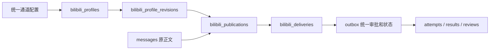

# V2 B站基础接入与发布合同

本批对应D5的基础读取、评论/线程回复、指定用户私信和真实mention组件接线，不代表完整B站能力、D5或V2完成。真实账号/站点控件及macOS/Linux尚未验收，默认入口仍为V1。字幕、用户搜索、ASR、抽帧等后续能力归D6；安卓继续接入。

## 使用顺序

1. 启动独立V2实例。通过凭据工作台保存Cookie JSON，须包含`SESSDATA`，可包含`bili_jct`、`DedeUserID`等字段。不读取V1的Cookie文件，也不接受URL凭据或任意本地登录目录。
2. 在配置中建立`channel/bilibili`，填写账号UID和凭据引用并明确启用。endpoint留空或为固定`https://api.bilibili.com`。每次读取和发送前核验提供方实际登录UID，Cookie内的UID不能代替登录核验。
3. 「B站」页面可读取当前账号、精确BV视频信息、评论及`BV:根评论ID`回复。拒绝、格式变化、超时和身份变化会报错，不以空结果冒充成功。短链、任意URL、名称搜索本批不接入。
4. 加载该通道页面规则，从空白模板填写并核验控件，再明确启用。账号从整页定位；目标须为包含编辑器、提交按钮和记录的容器，三者相对于该容器定位。默认无头浏览器适合服务器；取消后打开独立窗口。规则和浏览器模式一起版本化。
5. 保存的助手消息上有「准备 B站发布」，也可填写消息UUID。准备意图只创建待审批投递，不登录、打开浏览器或自动批准。到「持久投递」选择该记录，核对账号、真实地址、完整正文、规则修订和mention UID范围后逐条批准。

评论目标是`https://www.bilibili.com/video/BV...`，顶层线程回复附加唯一`?reply_id=根评论ID`；私信目标是`https://message.bilibili.com/#/whisper/midUID`。未保存的规则草稿不参与执行。准备操作仅接受来源有效的终态助手消息，不将QQ远程输出跨接到B站。

相同来源、目标及mention语义返回已有意图，即使请求key改变，也不能借此重新外发。重发复用既有投递的核查、parent与风险确认；unknown不自动重发。旧规则修订失效后不能静默重绑审批，本批须用新消息准备新意图。

## 页面字段和mention

字段结构示例，**不是已验证的真实站点选择器**：

```json
{
  "comment": {
    "account": "填写账号节点",
    "account_attr": "href",
    "target": "填写目标容器",
    "target_attr": "data-id",
    "editor": "填写容器内编辑器",
    "submit": "填写容器内提交按钮",
    "records": "填写容器内记录",
    "record_id_attr": "data-id",
    "record_author": "填写记录内作者",
    "record_author_attr": "href",
    "record_text": "填写记录内正文",
    "challenge": "填写挑战状态节点",
    "logged_out": "填写未登录状态节点",
    "mention_input": "填写候选搜索框或留空",
    "mention_options": "填写候选项",
    "mention_nodes": "填写编辑器内组件",
    "mention_uid_attr": "data-mid",
    "record_mentions": "填写发布记录内组件"
  }
}
```

账号/作者属性支持纯UID和受限的个人主页href；视频容器可用BV或经当前读取绑定的aid，回复容器须匹配根评论ID。URI、账号、目标、文档代次和节点身份分阶段重查。现有草稿不为空、控件不唯一、不可编辑、登录失效或出现挑战时停止，不覆盖原草稿。

mention形如`[{"start":7,"end":13,"uid":"222","name":"Alice"}]`，按Unicode字符计数，必须精确覆盖原文的`@Alice`。范围有序、不重叠；同一显示名不能绑定不同UID。浏览器按UID选唯一可见候选，核验编辑器组件及顺序，提交前再次检查，发布后核验记录内实际UID。候选、编辑器和发布记录组件须一起配置。纯@文本不冒充真实mention；私信mention本批拒绝。普通文字插入不触发Enter提交。

## 数据、权限与一次性提交



该批新增四表，基线为102张业务表、`v2_0028`；当前全库版本见[数据模型](DATA_MODEL.md)。规则修订、发布绑定和投递关联不可改写；关系有Agent作用域外键。发布没有另一套发送状态，不复制完整消息。mention只存UID和字符锚点，显示名由原消息导出；模型准备工具仅返回引用，读取工具正文只写入一次工具结果。删除来源后禁止发送，保留必要指纹、审计与核查关系。

准备意图、outbox和关联在同一事务提交。外部读取、等待及浏览器操作均在事务外。最终派发复用统一执行令牌、boot、租约、审批期限、配置和来源判定，并再次核验凭据代次。配置、规则或凭据变化不能取得旧许可。

`application/bilibili.py`提供查询、规则与准备用例及`bilibili_read`、`bilibili_prepare_publication`工具；后者不能批准或提交。`adapters/bilibili.py`持有异步读取和受管进程，`workers/bilibili.py`拥有独立浏览器。辅助进程不打开主数据库、不导入V1、不接收任意脚本；固定IPC同时校验方法、写属性、作用域和一次性观察令牌。

观察/填写期间仅允许GET/HEAD，阻止其他写方法、WebSocket和Service Worker。提交阶段只放行一次与批准正文、接收目标、线程及mention映射一致的固定B站发布请求；不主动调用写API，不处理验证码。站点格式变化会拒绝或进入unknown，不尝试其他写端点。

发送预算25秒、读取预算20秒；最多四个实际发布进程、四个实际读取槽位及八个已接收读取任务。Cookie从凭据端口获取并登记各值脱敏，不写Cookie文件，不回传到主机响应或诊断；子进程stderr仅登记字节数等元数据。任务持有真实进程归属直到回收成立，关闭超时保留残留、账号资源和实例锁。

sent同时要求页面实际发布请求的成功回执/记录ID，以及独立新浏览器上下文重新加载同一目标后，该唯一记录的账号、完整正文和mention核验。回读不沿用原页面的本地存储、缓存或乐观插入记录，每次发布最多两个浏览器上下文；原页面看似成功而服务端记录内容不同仍为unknown。它不表示已读或永远不会被审核。点击派发后响应丢失、回执或记录无法核验为unknown；派发前确定拒绝可为not_sent。取消不保证撤回，已填写的本地草稿可能保留。

## HTTP和验收

所有者认证的`/api/v1/agents/{agent_id}`下提供：

- `GET/PUT /bilibili/profiles/{config_id}`：完整规则及revision比较；请求上限64KiB。
- `POST /bilibili/read`：账号/视频/评论/回复；请求上限4KiB。
- `POST /bilibili/publications`：准备意图；请求上限16KiB。
- `GET /bilibili/publications`及`/{id}`：稳定UUID游标，单页最多100；列表不附带全部正文和历史。

离线覆盖真实SQLite、假HTTP、Cookie脱敏、撤权、语义重放、真实Playwright组件、受管辅助进程及实际回收、点击回执丢失、四视口双主题和审批前预览。页面与B站响应均由测试注入，不能替代真实接口/控件验收。

真实验收需指定账号、当前站点规则、可审阅的具体内容与目标，单独验证登录、读取、单次评论/私信、mention UID及发布后记录。本批无真实账号或外发操作；平台实机、全量、打包、负载和三平台72小时仍待完成。

浏览器接口参考[Playwright locator](https://playwright.dev/python/docs/api/class-locator)和[页面交互](https://playwright.dev/python/docs/input)，BV标识参考[B站官方播放器](https://player.bilibili.com/)。现有Web读取及页面网络格式属于待真实验证的站点适配，不宣称官方稳定API合同。
