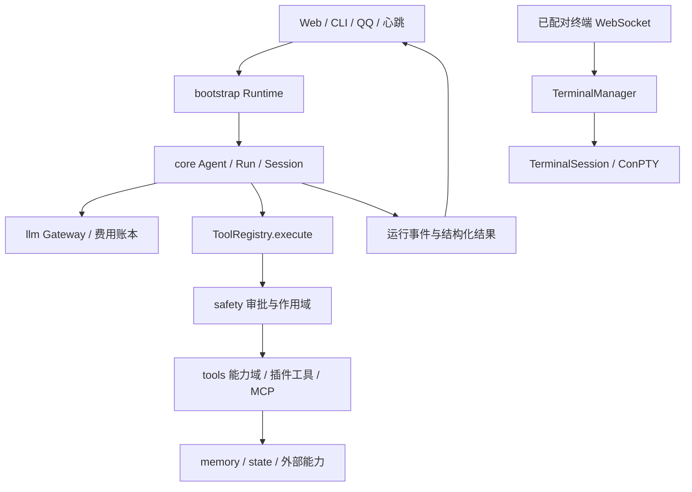

# 项目导航、模块分类与内部调用

本地 Agent 完整工程归 `agent/`。先读 [产品开发入口](../../../agent/README.md) 与
[仓库结构](REPOSITORY_STRUCTURE.md)，再按下列模块索引定位。原 `src/`/`tests/`
仅可作为迁移机器上的兼容目录联接；新开发与干净检出均使用 `agent/` 的正式位置。


接手仍从 [HANDOFF.md](../HANDOFF.md) 开始。[ARCHITECTURE.md](ARCHITECTURE.md) 是依赖、
职责和组装根规则的唯一权威。本文回答“功能在哪里、怎么调用、加功能去哪个文件夹”。
当前目录来自实际源码扫描，不把未实现功能画成现有模块。

设置中心“上下文”集中展示窗口统计与配置；HTTP 归 `web_api/context.py`，界面归
`ui/app/hub-context.js`，只读统计归内核，样本聚合归 RunStore，配置事务归 config_io。
详细接口和生效规则见 [CONTEXT_SETTINGS.md](CONTEXT_SETTINGS.md)。

提示词与上下文归 `core/context.py` / `core/compress.py`，回合快照存储归 `memory/store.py`，
工具规格归 `tools/registry.py`，供应商缓存 token 归一化归 `llm/usage.py`。
索引分类为“提示词与上下文”，设计和缓存边界见 [PROMPT_CONTEXT.md](PROMPT_CONTEXT.md)。

项目数据位置与源码模块位置分别索引：`/project/` 查询代码、调用和 API，`/storage/`
设置全局/Agent 目录并查看记忆、档案、文件、资料、日志等当前实际位置。
路径声明与用途索引在 `system/agent_spaces/`，UI/HTTP 在 `web/storage/`
和 `channels/web_api/storage.py`；完整布局与运维入口见 [STORAGE.md](STORAGE.md)。

## 1 三种索引入口

V2 需求从[功能开发地图](../index/FEATURES.md)进入。仓库根执行 `uv run --no-sync python scripts/project_index.py --feature android` 可定位安卓截图接口、组装和测试。下面的 `web_api`、`core` 和 `/project/` 属于 V1 工作台；其源码扫描器也供仓库开发命令使用。

### 维护一条功能记录

在 [features.json](../features.json) 找已有功能，确有独立职责时再增加记录。稳定的 `id` 可供会话交接直接引用；`aliases` 填开发者会使用的词，`pages` 填实际工作台页面 ID，每页归一个功能。填写用途、改动会影响哪些调用方，以及需要一起阅读的其他功能 ID。

`refs.entry` 列出第一处应读的代码，`refs.tests` 列出能直接运行的测试；其余分组按实际实现填写。引用使用仓库相对路径，Python 路径可带 `#类.方法`、`#外层函数.处理函数` 或 `#组装函数.唯一变量`。测试可引用整个测试文件或具体测试函数。导航生成时静态解析源码行号，专项命令会把测试符号转换成 pytest 的 `::` 目标。

从仓库根运行 `uv run --no-sync python scripts/project_index.py` 更新四份索引。用 `--check` 发现页面遗漏、失效路径与符号、重复 ID、无效测试及过期生成页。用 `--feature` 查询只读结果；多个候选时按返回的 ID 再查。

统一功能导航和手机区域切换由 `web/ui/` 提供；终端、任务、MCP、安卓
各专题可从顶栏进入。操作说明与异步目标隔离回归见 [UI_QA.md](UI_QA.md)。

- **可视化**：`uv run --no-sync omni-web-v1`，配对后点顶栏“项目与能力”，或打开 `/project/`。
  可搜索模块、路径、符号、接口、工具；查看请求字段、审批等级、注册状态、扩展契约和源码位置；API 支持按所属模块筛选，并可从接口详情跳到模块与依赖。
  文档可在页面直接阅读。该页不执行工具、不连接 MCP 或社区、不激活插件。
- **文件导航**：[index/MODULES.md](../index/MODULES.md) 按模块列出源码、职责、测试和说明文档；
  [index/API.md](../index/API.md) 列出 HTTP/WS、请求模型、关键调用链和静态工具声明。
- **机器查询**：[index/project.json](../index/project.json) 包含分类、文件、公开符号/参数、
  内部 import、API、注册声明和调用链定位。实际启用工具另查 `/api/workbench/tools`。

```powershell
uv run --no-sync python scripts/project_index.py
uv run --no-sync python scripts/project_index.py --check
# 支持 --root <源码根> 与 --output <输出目录>；不创建 Runtime、不读取真实 data。
```

生成内容由 `system/catalog/schema.py` 的模块分类和 `scan.py` 的 AST 扫描共同得到。
`--check` 在文件缺失或过期时返回 1，不修改文件。指纹按规范化 UTF-8 源码计算，不依赖 Git。
工作区有未提交前端/API 改动时，生成结果与已提交索引不同属于正常差异；正式提交前须对
实际提交源码重新生成和检查，不能把别的并行工作混入索引。

## 2 实际目录与职责

```text
agent/src/omni/
  bootstrap.py              唯一运行时组装根，通道使用 Runtime
  config.py                 配置模型、兼容版本与全部可注入路径
  core/                     编排与上下文：agent/run/session/review/cron/retrieval/vision
  llm/                      Gateway、能力/费用/超时、流式与 embedding 适配
  memory/                   memory.db/state.db、技能/修订/产物/隔离安装与账本
  safety/                   风险、人工/无人值守策略、smart 与审批 broker
  tools/
    registry.py             统一 Tool 契约、注册、规格、派发、只读元数据快照
    result.py / runctx.py   结构化结果与回合引用
    pathpolicy.py / shots.py 共享路径策略、截图产物协议
    personal/               个人工具的聚合注册入口
      clock.py              时间
      facts.py              事实与历史检索
      profile.py            档案
      resident.py           常驻笔记
      todos.py              会话待办
      digest.py             活动摘要
      refine.py             当前会话整理请求
    skills/                 技能读写/版本/回滚、外来技能包工具入口
    scheduling/             cron 注册、编辑、一次性任务与执行查询
    delegation/             受父运行约束的子任务工具
    system/                 系统服务的工具适配（非基础设施实现）
    shell/                  SAFE 参数解析、执行器、硬黑名单和 CONFIRM 命令
    files/                  工作区路径、搜索、读写、冲突和回滚
    web/                    公开网页抓取与正文提取
    browser/                Playwright 所有者线程、观察、表单与预算
    android/                ADB、UI 树、观察动作与中文输入
    desktop/                Windows UIAutomation、窗口身份、观察与语义动作
    bilibili/               读 API/转写、草稿与受控 UI 写
    qq/                     OneBot 客户端及主动消息工具
    mcp/                    外部进程的工具发现、授权和调用适配
  plugins/
    manifest.py             包身份与声明校验
    host.py                 隔离/激活/指纹/注册/启停/卸载
    tools.py                面向对话的插件生命周期工具
    community/
      client.py             社区 HTTP、校验下载与发布
      tools.py              community_* 对话工具
      server.py             独立社区参考服务器
    server.py               旧启动命令兼容层
  channels/
    cli.py / qq.py / heartbeat.py   三类入口适配
    web.py / web_auth.py     应用生命周期、统一鉴权、配对/设置与静态挂载
    web_api/
      __init__.py           领域路由聚合，显式注入同一 Runtime
      schemas.py            共享请求模型；web.py 保留旧名称转发
      sessions.py           会话、历史、状态与待办
      conversation.py       普通/流式对话、显式运行入口
      runs.py               运行/事件/取消与费用
      memory.py             事实、档案、常驻、review 与检索状态
      skills.py             技能编辑/修订/差异/回滚/审阅
      artifacts.py          产物查询、指纹回读与清理
      approvals.py          待审批查询与人工决定
      mcp.py                MCP 状态/发现/权限复核/重连
      operations.py         系统、服务、doctor、备份与日志
      automation.py         任务与 outbox
      publications.py       草稿编辑与未知结果核查
      devices.py            桌面与安卓观察/动作/视频流
    terminal/
      backend.py            ConPTY 平台可用性与创建
      session.py            一条 PTY 的读/写/调整/退出
      pool.py               限额、会话归还、有界关闭与残留
      routes.py             终端 WS 握手、双向流与断开清理
    workbench/routes.py     项目/能力/扩展状态与限定文档读取
    web_static/
      index.html            现有对话工作台
      project/              项目导航 HTML、CSS、JS，分别维护
  system/
    catalog/                源码扫描、模块分类与索引输出
    services.py / process_identity.py  服务与 OS 身份/资源/回收
    atomic.py / filelock.py  共享文件事务原语
    config_io.py            定向配置写回
    observability.py        有界日志与脱敏
    doctor.py / backup.py   只读诊断、快照与恢复
    soak.py / release_gate.py / provenance.py  验收与版本证据

agent/tests/                      默认离线回归；命名与能力域对应
scripts/                    CI、索引、静态扫描、评测和显式手动验收命令
docs/v/index/               自动生成的源码/API/机器索引
docs/v/evidence/            可提交的脱敏验证证据
skills/                     SKILL.md 与 references 数据
config/                     声明配置（凭据按既有安全策略管理）
data/                       本机运行态，默认不入库；测试必须替换路径
```

旧的 `tools/builtin.py`、`*_tools.py`、`shell_tools.py` 只做明确 re-export。
现有外部 import 可继续使用，新代码从能力包导入；不得在兼容层新增业务。
`channels.terminal`、`plugins.community` 的公共 import 和 `python -m omni.plugins.server`
继续可用。终端后端替换应针对 `terminal.backend`，不要依赖旧文件的私有全局变量。

## 3 几种“扩展”不能混为一类

| 类别 | 内容与入口 | 执行边界 | 接入位置 |
|---|---|---|---|
| 内置工具 | Tool + JSON Schema + register_xxx_tools | Registry → 审批 → 工具；核心依赖 bootstrap 注入 | `tools/<域>/` |
| 交互式终端 | 人在工作台输入的 PowerShell 会话 | 配对 WS 与会话池；不经过模型 SAFE 命令解析 | `channels/terminal/` |
| Agent shell | 模型申请的命令 | SAFE 受限 argv；任意命令人工确认、硬黑名单仍拒绝 | `tools/shell/` |
| Python 插件 | manifest.json + plugin.py | 隔离校验零执行；人工激活后是受信代码；工具名带插件前缀 | `plugins/`，安装态在注入 data/plugins |
| 技能 | SKILL.md + references | 提示/参考数据；不执行附件脚本；更新走 CAS/历史 | `memory/skills.py`、`tools/skills/` |
| MCP | 配置的外部 stdio 服务 | 进程外发现/目录漂移与既有授权链；非可信 OS 沙箱 | `tools/mcp/` |
| 插件社区 | 搜索、详情、分发、发布 | 下载校验后仍需本机激活；发布必须人工批准 | `plugins/community/` |

扩展按可执行契约归入 plugins、tools/skills 和 tools/mcp；终端属于独立交互入口。
各模块复用既有 Agent、Registry 和审批链，分类与实际执行边界保持一致。

## 4 对话、内部 API 和调用链



这是主要职责链路；精确处理函数和源码行见生成 API 索引。并非所有箭头都是 Python 直接
import，领域间通过注入协议、回调和 Runtime 协作，必须遵守 ARCHITECTURE 的依赖方向。

| 场景 | 对外入口 | 内部主要契约 | 前端位置 |
|---|---|---|---|
| 普通对话 | POST `/api/chat` | ChatIn → Agent.run_turn → Gateway.complete → ToolRegistry.execute | 对话页 |
| 流式对话 | POST `/api/chat/stream` | ChatIn → 流式响应；Gateway.stream；工具与结果仍保持消息不变量 | 对话进度 |
| 持久运行 | POST/GET `/api/runs`；GET `/api/runs/{id}/events` | RunStore + ActiveRuns + event seq | 运行进度与断线续读 |
| 停止 | POST `/api/runs/{id}/cancel` | 本进程协作取消；跨进程限制如实返回 | 停止本回合 |
| 审批 | GET `/api/approvals`；POST `/api/approvals/{id}/resolve` | ApprovalBroker/WebApprover；不直接执行任意工具 | 审批横幅 |
| 终端 | WS `/api/terminal/ws` | 先验 Host/Origin/cookie，再开 PTY；双向流与有界回收 | 终端按钮 |
| 项目目录 | GET `/api/workbench/project` | 源码 AST 与模块分类；最多缓存 5 秒 | 项目与能力 → 模块 |
| 实际工具 | GET `/api/workbench/tools` | Registry.describe；只读快照，含条件/动态注册 | 项目与能力 → 工具 |
| 扩展状态 | GET `/api/workbench/extensions` | 已注入 PluginHost 的隔离/启用状态；不装载代码 | 项目与能力 → 扩展 |
| 限定文档 | GET `/api/workbench/docs/{name}` | 显式目录清单；不提供任意文件读取 | 模块说明与架构阅读 |

静态 Tool 声明不表示工具已启用：配置开关、后台 worker、平台可用性和插件激活会影响注册。
MCP 的远端目录只有用户显式发现后才读取；索引页不会为了显示能力主动连接外部服务。
请求模型列的是源码字段与必填性，不回显配置、参数实例、历史对话或密钥值。

## 5 新功能放到哪里

1. 找到职责模块与已有公开契约。新本机能力放 `tools/<域>/`；插件/MCP/技能按上表选入口。
2. 驱动/API、工具包装、存储分别放领域底层、`tools.py`、`memory/`，通过 bootstrap 注入。
   不在工具中构造 Agent/Gateway，不跨工具域 import，不从 memory/safety 倒挂插件宿主。
3. 核心业务 Web 接口在 `channels/web_api/<领域>.py` 导出 `create_xxx_router(runtime)`，在
   web_api/__init__.py 聚合；独立工作台专题沿用 `channels/<专题>/routes.py`。在 web.py
   include_router，继承 `/api/` 统一鉴权。新前端专题使用独立目录和 HTML/CSS/JS。
4. 需要持久化先扩展 RuntimePaths/注入路径；默认套件只用临时数据和假外部依赖。
5. 更新 `system/catalog/schema.py` 的分类、相关测试与文档；需要时补关键调用链定位。
   生成索引，`--check`、架构守卫和全量 pytest 通过，再提交自己的改动。

索引解析 AST 和受限文本资源，不导入待索引模块。它不是 Python 动态执行的数据流证明，
也不以源码行数或工具数量判定产品完成。真实设备/账号/模型和稳定版门槛仍见
[ACCEPTANCE.md](ACCEPTANCE.md)。

## 6 重构与兼容验证

最新路线与本批边界见 [REFACTORING.md](REFACTORING.md)。
`agent/tests/fixtures/web_api_v1.json` 从已发布 934618f 的隔离源码提取，冻结 90 个 HTTP 操作和
23 个 OpenAPI schema；方法/路径、参数、请求/响应与 operationId 必须兼容，分组 tags 可调整。
共享请求模型和路由聚合分别拥有索引分类，避免把装配依赖与数据契约合成表面循环。

## 能力专题入口（C01–C06）

- /terminal/：人工 PTY，会话与配对身份归属；/jobs/：可审批后台命令。
- /mcp/：本地 stdio 状态、完整目录、人工复查与日志。
- /android/：设备选择、观察、应用动作与共享预览；/capabilities/：被动诊断。
- 工具/HTTP/迁移声明/平台管道按实际职责分类；源索引会定位 shell_job 四工具及新增接口。
- 详细限制与真实验收缺口见 CAPABILITIES_PLAN.md、TERMINAL.md、MCP.md、ANDROID.md。
