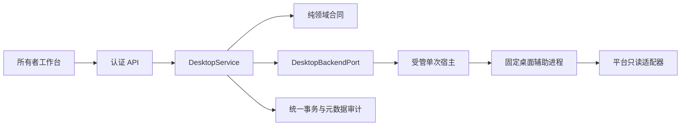

# V2 原生桌面：发现、权限与目标身份合同

> 文档范围：本页维护该能力合同与所属批次记录。当前默认入口为 V2；[当前交接](../../HANDOFF.md)区分已实现、专项通过和原生验收，历史测试数字不覆盖当前源码。

## Windows 单次前台输入（D1.windows.foreground）

前台种类为 type_text（1–128字符）、有限按键和基于重新核验控件的点击；客户端不能提交坐标。必须另有 takeover=true，使用 desktop-foreground-1 策略；每次绑定本次运行、目标、观察、动作、授权与启动代次。审批后由用户手动切换到目标控件，生产代码不抢焦点。

辅助进程最多等待10秒，并等待按键释放和250ms静止期。目标与焦点通过后只发送ready；宿主再次核验审批、策略、会话和视图后发送permit，初始请求不授权系统输入。随后核验身份、用户介入与焦点，执行一个有界SendInput批次，不连续自动推进下一步。

低级键盘/鼠标及前台/焦点监听在独立消息循环线程运行。自身注入事件使用本次标记；其他输入或焦点事件使动作暂停/拒绝。部分输入只释放已接受的本次未配对按下，不重复文字或点击。仅有明确文本追加后置证明时可返回成功；按键、点击和不明结果保持unknown，不自动重放。

输入接口支持离线注入以验证协议、部分接受、用户介入、撤权、监听丢失和回收失败。生产固定PowerShell只选择真实原生实现，IPC不能选择测试实现。离线通过不证明系统键鼠实测通过。显式验收脚本为 `agent/scripts/accept_foreground.py --output <全新证据目录>`，仅操作它创建的隔离窗口；需用户点击文本框并暂时保持键鼠静止。本次用户已要求稍后验收，因此不运行该脚本。

依据：[SendInput](https://learn.microsoft.com/en-us/windows/win32/api/winuser/nf-winuser-sendinput)、[低级键盘监听线程](https://learn.microsoft.com/en-us/windows/win32/winmsg/lowlevelkeyboardproc)、[WinEvent 生命周期](https://learn.microsoft.com/en-us/windows/win32/api/winuser/nf-winuser-setwineventhook)。


## 分层与运行



领域层只校验数据、身份和协议，不导入原生 API、文件系统或进程库。应用层绑定 Agent、视图、期限和审计；HTTP 不直接调用原生库。组装根只构造窄接口，默认启动不查询或扫描桌面。平台原生调用只发生在显式请求启动的固定辅助进程中。

当前协议 `omni-desktop-ipc-5` 允许 `probe / targets / verify / observe / capture / act / foreground`，精确字段、请求 UUID、操作名和响应相互绑定。普通操作为单次 JSON 帧，foreground另有绑定的ready/permit控制帧；stdout 与 stderr 合计最多 64 KiB。stderr仅计数后丢弃，不转为用户消息、日志或任意异常正文。失败输出静态错误码，不能用空窗口列表冒充未接入或无权限。

宿主最多4个实际操作、2个驻留辅助进程。普通操作5秒、foreground15秒总预算均包括排队、启动与IPC；回收有独立持有的真实任务。取消HTTP等待不取消实际派发、读管道或回收。回收未完成时保留进程对象和容量，close返回false，后续继续回收。辅助进程不打开主数据库，不继承凭据和任意远程会话总线地址。

## 能力报告与当前范围

固定能力为 `window_identity`、`accessibility`、`screen_capture`、`foreground_control`。每项分别报告 supported、installed、permission、available、error_code、limitations 和 recovery。操作系统允许某项权限，不代表本程序已有对应适配器；已安装也不代表当前可用。

| 平台 | 当前实现 | 明确未接入 |
| --- | --- | --- |
| Windows | 会话/进程/窗口身份、UIA、截图、语义动作、逐次授权前台文字/按键/点击 | 真实前台键鼠和完整平台验收待完成 |
| macOS | 固定Swift源码、audit/libproc、AX、ScreenCaptureKit、语义及逐次前台输入；构建、CI和隔离验收接线 | Swift编译、全部原生行为、PTY/Keychain及完整实机验收 |
| Linux | logind/总线身份、AT-SPI观察、Xorg/XRes/Composite截图、Wayland Portal授权、FD与窗口单帧源码 | Linux语义/前台控制、PTY/凭据与Linux完整实测 |

无交互会话时不能报告available=true。Windows Session 0、非活动WTS会话、不可见窗口站、非当前输入桌面均拒绝观察。macOS安装并核验固定Swift应用后由它报告自身权限；缺少辅助应用时仍可给出Python诊断，但installed/available保持false，其权限不授权Swift。Linux的DISPLAY、WAYLAND_DISPLAY或安装包存在都不能证明登录身份和授权，首批不连接这些变量指定的显示端或总线。

本批 Windows 原生样例只使用隔离进程创建的空标题、离屏、非激活临时窗口并直接核验该句柄。它不能代替真实应用、多屏缩放、登录切换、权限撤销或完整 Windows 平台验收。macOS/Linux 的目标类型检查及假平台测试也不能标记为实机已支持。

## 所有者视图与目标引用

HTTP 全部要求既有所有者认证。进入分区只建立元数据视图，不触发原生能力检查或窗口列举。每个原生查询都需要显式 consent=true。

```text
GET    /api/v1/agents/{agent_id}/desktop
POST   /api/v1/agents/{agent_id}/desktop/view
POST   /api/v1/agents/{agent_id}/desktop/probe
POST   /api/v1/agents/{agent_id}/desktop/targets
POST   /api/v1/agents/{agent_id}/desktop/verify
POST   /api/v1/agents/{agent_id}/desktop/observe
DELETE /api/v1/agents/{agent_id}/desktop/snapshot?view_id={uuid}
```

`view` 和 `probe` 请求为 `{consent:true,view_id:UUID}`；targets 另有 limit（1–50）；verify 和 observe 另有 snapshot_id 和 target_id。原生 HWND、PID、进程创建时间等证明只能来自服务端已捕获的目标，客户端不能提交任意原生目标。view_id 用于并发及视图归属，不替代认证或动作审批。

同一 Agent 一次只执行一个观察操作，应用待处理上限 8。最多保存 8 份视图诊断，其中最多 4 个有效窗口快照，每份最多 50 个目标。容量满时明确拒绝；诊断缓存淘汰不会驱逐仍有效的窗口快照。视图按 Agent 隔离，快照还绑定本次启动和 view_id，60 秒后拒绝访问，重新检查权限也会废弃旧快照。

建立新视图使旧视图失效。离开、隐藏或更换 Agent 时，工作台清除 DOM、目标引用和计时器，发送带旧 view_id 的条件释放；旧响应与旧清理不能清除新视图。前端对同 Agent 的建立请求串行，迟到结果按视图和页面代次丢弃；无后台窗口轮询。缓存能力标记“上次检查”，不能暗示锁屏或切用户后仍实时可用。

应用在审计等待后复核视图，并将复核回调传给宿主。宿主取得容量、启动辅助进程后且写入请求帧前再次检查视图、期限及关闭状态。用户已离开或期限已到时，不再派发新的观察；已经派发的只读工作继续受管回收，其结果不能附着到新视图。

## 原生身份的含义

内部目标包括 platform、backend、native_id、pid、process_created、application_id 和 session_id。窗口列表不保存或返回标题、界面正文、截图、剪贴板。工作台只展示应用标识和 PID，操作引用使用服务端生成的 target_id。

Windows 在持有目标进程句柄时核验当前用户 SID、会话、桌面、存活状态、创建时间和可执行程序，并在列举/核验前后重复检查；所有打开的句柄由该请求回收。身份不匹配返回 false，该目标引用作废。匹配只证明当前元数据一致；同一进程内 HWND 可能被复用，因此不能据此授予之后的任何动作。后续 UIA/截图/输入须建立新的观察和审批合同，不复用本批 opaque ID 作为操作授权。

快照只在内存中存在，不进入业务库。重启后无法恢复，也不重放旧观察或按历史 PID 操作系统进程。UIA 树不增加永久存储。截图属于用户显式保存的内容，以 session_captures 引用现有对象，数据库为95表、v2_0023。

## 日志、审计与关闭

原生请求前持久登记 `desktop.observation_requested`，完成后登记 `desktop.observation_completed`。只记录操作、数量、截断和 matches 等元数据；不保存 exe、native_id、session_id 或目标正文。未成功结算不得返回观察成功。该元数据审计未加入既有 180 天删除政策，不能按年龄自动裁剪新种类。

四个观察用例使用固定 desktop 指标类别和 span，关联 request_id、agent_id、operation_id、trace_id。临时调试与指标共用固定操作白名单，禁止使用应用路径或窗口标识作为标签。诊断导出只包含活跃数、缓存数、回收数等汇总，不包含快照内容。

关闭先停止新观察、撤销视图，再等待实际应用任务与审计（phase 0），然后回收原生宿主（phase 1）；真实任务或进程未回收时，不关闭存储或释放实例锁。观察和系统权限是不同真值，面板释放不会撤销操作系统权限。

## Windows UIA 内容观察

IPC升级为`omni-desktop-ipc-4`，不保留旧辅助程序协议。`observe`请求沿用consent/view/snapshot/target UUID；宿主在排队及spawn后派发前重新核验视图和期限。固定系统Windows PowerShell以NoProfile/NonInteractive/MTA运行包内`windows_uia.ps1`和`windows_uia.cs`，没有命令字符串、V1依赖或主进程UIA调用。进程依旧受Job、4实际操作/2宿主、5秒及64KiB管道限制约束。

辅助程序持有进程句柄，检查SID、创建时间、程序、WTS活动会话、可见窗口站与当前输入桌面；观察前后复核身份和当前UIA根对象。RuntimeId只在短期观察内结合根、控件类型和名称指纹做候选定位，不能独立证明身份或授权；执行辅助程序必须重新遍历并复核全部目标证明。PID/窗口重用仍不能仅靠元数据证明长期身份。

最多128节点、8层、每个name/text字段512字符，合计16KiB UTF-8文本。只使用可限制长度的TextPattern，不读取无长度限制的ValuePattern；密码控件及其子树不采内容。主进程再次校验树、身份、数值、文本预算与密码字段。输出超限裁掉尾部节点并明确truncated；错误、权限撤回或超时不返回成功空树。

响应包含新observation_id、observed_at、target_id、snapshot_id、expires_in_s、opaque节点/父节点UUID、角色/文本/边界/可见状态和truncated。节点UUID可用于另行提交动作审批，不等于已获授权；原生引用不返回客户端。正文不保存在视图缓存、审计、诊断或指标；完成审计失败、视图改变或过期不发布结果。前端显式“读取界面内容”，textContent渲染，离开/过期清除；迟到内容不能重现。

辅助程序两份源码纳入启动build_id、部署捕获、包一致性和源码索引。当前只做隔离测试窗口验收，不读取用户实际窗口；尚未完成Windows完整原生、Mac/Linux及72小时验收。

## 后续原生适配门槛

Windows已接入逐次授权的前台文字、有限按键及控件点击；原生输入实测按所有者安排稍后进行。下一开发交付为macOS固定Swift应用，编译、原生输入和平台验收仍待推进。

macOS 建立固定 Bundle ID、安装位置和版本化 Swift 辅助应用，交付构建、签名、指纹和权限诊断流程。AX、ScreenCaptureKit 和输入监测权限绑定辅助应用自身；显式申请权限与只读 probe 分离。不能跨进程保存裸 AX 指针，应绑定本次 helper、进程创建身份、应用、登录会话和短期对象租约，失效后重新观察。

Linux 先证明 logind 活动会话和 UID，核验规范本机总线/显示连接的所有者和 peer UID，再接 AT-SPI。不能仅靠 `_NET_WM_PID` 或任意 DISPLAY 信任窗口所属进程。Wayland 使用显式 Portal 授权及唯一总线所有者、会话句柄和取消/撤权生命周期；不具目标身份或暂停条件时不开放前台操作。

完整原生动作、真实账号业务、三平台安装及 72 小时验收仍待进行。本批不执行服务注册、启停、实际设备输入或发布。

参考：[EnumWindows](https://learn.microsoft.com/en-us/windows/win32/api/winuser/nf-winuser-enumwindows)、[Apple AXUIElement](https://developer.apple.com/documentation/applicationservices/axuielement)、[ScreenCast Portal](https://flatpak.github.io/xdg-desktop-portal/docs/doc-org.freedesktop.portal.ScreenCast.html)。

## 窗口截图与持久引用（D1.windows.capture）

- `POST /api/v1/agents/{agent_id}/desktop/capture` 必须提交 `consent=true、view_id、snapshot_id、target_id、session_id`。目标均为服务端短时 opaque ID；客户端不能指定 HWND、PID、输出路径或全屏区域。会话必须属于当前 Agent 且未删除。
- 固定 MTA PowerShell/.NET 辅助程序使用 PrintWindow(0) 获取目标窗口，设置本线程 DPI 上下文，持有目标进程句柄，采集与落盘前后核验 SID、进程创建身份、登录会话、输入桌面和窗口矩形。最小化、cloaked、已报告的内容保护、尺寸变化、调用失败拒绝发布。PrintWindow 为同步阻塞调用，仍受主进程 5 秒总期限与 Job 回收约束。参见 [Microsoft PrintWindow](https://learn.microsoft.com/en-us/windows/win32/api/winuser/nf-winuser-printwindow)、[显示保护查询](https://learn.microsoft.com/en-us/windows/win32/api/winuser/nf-winuser-getwindowdisplayaffinity)。
- 限制 8192 像素单边、1600 万像素、PNG 16 MiB；图片通过主进程生成的私有 `run/desktop-captures/<uuid>/frame.png` 传递。IPC 只返回尺寸、SHA256、大小及采集方式，不载入大图片。宿主单个有界 I/O 工作者核验常规单链接文件、大小、指纹、PNG 解码、RGB 和实际尺寸；纯色画面拒绝发布。
- 没有全桌面回退；部分硬件加速应用可能返回失败或不完整画面。非纯色且合法的 PNG 只能证明采集完成，不能证明所有控件均完整显示，也不证明模型已看过。工作台明确显示“已保存，未附加到模型请求”。截图可能包含屏幕中可见的私人内容；UIA 密码不读取合同不意味着截图可以自动识别并遮挡所有敏感区域。
- 会话内容代次在排队后、辅助程序启动后、文件发布前及登记事务内重新核验。对象注册、会话引用、发布审计共同提交；失败留下的无引用对象由既有孤儿回收策略处理。HTTP 等待者取消不取消真实工作，关闭继续等待实际文件任务及进程回收。
- 离开面板、切换 Agent 或视图撤销后清除内存预览并丢弃迟到显示。提交已完成的截图仍可在会话截图记录中找到；视图撤销不撤销已完成持久保存，也不授权桌面写动作。
- `GET .../sessions/{session_id}/captures` 使用 UUID 游标、每页最多 100 条；`DELETE .../captures/{capture_id}` 只释放当前会话引用并审计。真实组合外键隔离 Agent。引用中的对象不被 GC；固定及其他引用继续保护对象。删除整个会话时释放截图引用；删除单条消息不会删掉独立保存的截图，但会阻止旧内容代次下的在途采集。
- 正常退出只删除当前请求拥有的固定临时文件和空目录，不递归清扫。删除失败保留进程宿主槽位并报告 cleanup_pending；重新关闭可重试。能力检查和截图前有界盘点暂存区（最多 100 个未归属项目），历史崩溃残留进入能力状态与 doctor，不自动删除私人文件。停机后人工核对；它们不是已登记对象，不纳入业务备份。
- 本次包含隔离窗口的真实 Windows 截图；三平台、受保护/硬件加速应用矩阵及 D1 整体实测仍未完成。详细结果单独登记在 [截图证据](../../evidence/v2-capture.json)。

创建时间在原生 IPC 中使用 `ieee754:` 加 16 位十六进制编码；C# 从 FILETIME 整数比例执行一次最近偶数舍入，不经过 Framework decimal/double 或 PowerShell 浮点 JSON 往返。宿主还原后继续精确比较，不允许容差。10,004 组固定数值回归覆盖旧转换误差、边界和精确小数。

## 所有者语义动作

`POST /api/v1/agents/{agent_id}/desktop/actions`精确接收consent、view/snapshot/target/observation/node/session/request UUID以及kind、text。只允许invoke/select/set_text，文本最多512字符；不接受HWND、PID、RuntimeId、任意脚本或自动重试。相同请求ID与正文只返回既有运行，不因视图过期再次派发。

选定节点先形成不调用模型的owner运行，与消息、去重及工作项一起入队。已有actions/approvals保存动作参数、策略与状态，审批建立时owner_commands清空参数。工作台在原视图显示审批详情、批准/拒绝、取消及显式状态刷新；离开或观察过期会撤销后续派发。没有隐式模型调用、原生轮询或自动批准。

派发前两次核验视图与期限、会话内容代次、运行状态、精确动作和审批策略；持久资源租约与全局desktop执行锁共同限制并发。辅助程序持有进程句柄，核验SID/WTS/输入桌面、创建时间/程序及目标，按128节点/8层上限重新定位控件并核验根、类型、名称指纹；拒绝密码、不可用、不可见或不支持的控件。GetLastInputInfo与前台窗口在执行和后置观察前后保持一致，否则拒绝未派发动作或将已派发动作结算为unknown。不会自动激活目标或模拟键鼠。

选择检查IsSelected，文本设置通过有界TextPattern回读；无法证明后置状态时进入unknown。Invoke返回只证明调用返回，不能证明应用业务完成，故进入独立核查。结果未知、超时、崩溃和无法回收都禁止自动重发；原生操作仍在运行时现有动作核查拒绝结论。取消等待不丢弃实际子进程或租约，关闭残留保留数据库和实例锁。

本次验证只操作测试进程创建的非激活窗口和临时数据，不操作用户已有应用，不等同于Windows完整原生验收。模型接入、显式前台接管及Mac/Linux仍待开发。

参考：[Microsoft InvokePattern](https://learn.microsoft.com/en-us/dotnet/api/system.windows.automation.invokepattern.invoke)、[ValuePattern文本设置](https://learn.microsoft.com/en-us/dotnet/framework/ui-automation/add-content-to-a-text-box-using-ui-automation)。

## macOS逐次前台输入源码合同

沿用desktop-foreground-1及同一owner运行、审批、租约、撤销与unknown核查。ForegroundCore只编排端口，等待手动焦点、按键释放和250ms静止，最长10秒；quiet至arm之间的输入代次变化也拒绝。初始请求不授予输入权，ready携带原请求/授权/运行/动作身份；宿主重新核查后permit必须精确匹配。

原生端口预分配一个CGEvent按下/释放事件对；文本最多128个Unicode标量，不分块续写。固定按键不支持修饰键和任意快捷键，点击点来自重新核验的控件。动作前核对前台PID、AX窗口及焦点，CGEvent投递至已核验的目标PID，不调用激活或设置焦点API。

会话级监听统计外来输入代次，目标PID监听确认本次两个不同标记，不能用两处监听重复计数。AX焦点通知与工作区激活/睡眠/会话通知单独持有并回收，缺少目标通知支持或任一权限则拒绝。监听不采集按键文本。发送返回不是成功证明；不能证明有界原文、选区及精确追加时保持unknown，按键与点击同样不宣称业务成功。

无前台输入自动重试；中断或监听丢失保留未知状态。清理只允许释放本次已投递的未配对按下，并重新核验原进程身份。Mac原生源码与9个Swift离线用例目前尚未编译，Python注入验证不能证明这些OS行为；完整步骤见Mac交接。

依据：[目标PID投递](https://developer.apple.com/documentation/coregraphics/cgevent/posttopid(_:))、[目标PID事件监听](https://developer.apple.com/documentation/coregraphics/cgevent/tapcreateforpid(pid:place:options:eventsofinterest:callback:userinfo:))、[Unicode事件载荷](https://developer.apple.com/documentation/coregraphics/cgevent/keyboardsetunicodestring(stringlength:unicodestring:))、[AX焦点监听](https://developer.apple.com/documentation/applicationservices/1460133-axobservercreate)。

## Linux X11窗口采集

目标分为AT-SPI语义观察与X11窗口采集，公开列表分别报告can_observe/can_capture；没有PID或坐标匹配到另一后端的回退。X11使用logind显示、实际socket与受保护Xorg身份，XRes提供真实客户端PID。只读取已重定向窗口的Composite pixmap，监测本次结构事件并在发布前后复核身份，不重定向窗口、不读取根窗口、不执行输入。格式、尺寸、超时、文件及对象约束与现有截图链共用，来源为x11_composite。跨调用XID不能证明永久对象身份；元数据不授权写操作。完整限制与Linux验收步骤见Linux交接；当前Windows注入验证不能标记Linux已支持。


## Wayland长驻授权与现有视图的关系

`DesktopPortalService`独立于单次观察服务，只通过`require_view`核验短期所有者视图。组装根构造两者并注入撤回回调，不让HTTP或通道访问平台总线。POST/GET/DELETE `/api/v1/agents/{agent_id}/desktop/portal`管理view/boot/grant绑定的临时授权；不接受HWND、PID、总线路径或设备类型。requested、authorized、closed审计只记录元数据，审计失败不授予可用权限。

Portal IPC2独立于桌面IPC6：选择等待90秒、会话总生存150秒，使用同一桌面2-helper实际容量。视图替换、重查、离开、缓存淘汰和排空均撤回；回收失败保留真实进程、容量、审计结算与实例锁，关闭可重试。已接OpenPipeWireRemote、serial绑定消费者及单帧对象引用；capture_available依据实际依赖、审计及本次授权报告。工作台支持手动选择、查询、保存与结束共享；没有自动轮询或输入授权。详细合同、ScreenCast6限制和原生样例见[Linux交接](../platforms/linux/V2_LINUX_HANDOFF.md)。只读链路源码及所选离线验证已接通；D3整包和Linux实机仍待完成。

## Linux语义动作与逐次放行

AT-SPI在完整有界观察中产生作用于当前视图的路径/祖先/名称/文本/能力证明，只有已核验X11输入守卫时才暴露候选；Wayland仍只读。Linux语义辅助程序使用ready/permit，主进程在真正派发前再次核验现有运行、审批与视图。一次RPC后严格回读，调用或未知副作用进入原核查，不自动重发；不抢焦点、不全局注入输入。IPC6精确区分各平台证明，95表与v2_0025不变。完整限制和实测步骤见[Linux交接](../platforms/linux/V2_LINUX_HANDOFF.md)，离线证据见[语义动作批次](../../evidence/v2-linux-control.json)。

## 历史批次状态（非当前结论）

以下原记录中的默认入口与完成度仅属于当时源码；当前默认入口为 V2，实际进度以当前交接和任务为准。

> Windows 发现、UIA 观察、截图、所有者语义动作及逐次前台输入已接通既有运行、审批、租约与核查。真实键鼠验收按所有者安排稍后进行。macOS已加入身份、AX、截图、语义及前台输入源码，尚未编译或完成原生实测，详见[Mac mini交接](../platforms/macos/V2_MACOS_HANDOFF.md)。Linux已接通logind/实际socket身份、AT-SPI观察与Xorg/XRes/Composite截图源码链路；Linux运行仍待实测，Wayland授权/窗口单帧源码已接入；X11监测支持的AT-SPI语义动作已接入；Linux前台及Wayland控制仍未完成，原生画面尚未验收，详见[Linux交接](../platforms/linux/V2_LINUX_HANDOFF.md)。整个V2尚未完成，默认入口仍为V1，尚未向模型开放桌面工具。
